# Busya — Diagramas de flujo

> **Proyecto:** Busya — información de colectivos de Villa Mercedes (Solbus)
> **Documento complementario:** [`DOCUMENTACION.md`](DOCUMENTACION.md)
> **Fecha de relevamiento:** 28/10/2026
> **Alcance:** flujos reales del código actual, incluyendo las fallas conocidas.

Este documento reúne los diagramas de flujo de Busya en formato **Mermaid**. No describe una versión ideal: describe **lo que el repositorio hace hoy**, y marca en rojo los puntos donde el flujo se corta o queda incompleto. Las referencias de código y los detalles de cada módulo están en [`DOCUMENTACION.md`](DOCUMENTACION.md).

---

## Índice

1. [Cómo leer los diagramas](#1-cómo-leer-los-diagramas)
2. [Flujo general de extremo a extremo](#2-flujo-general-de-extremo-a-extremo)
3. [Mapa de navegación entre páginas](#3-mapa-de-navegación-entre-páginas)
4. [Consulta de horarios: `index.html` → `paradas.html`](#4-consulta-de-horarios-indexhtml--paradashtml)
5. [Resolución del día de servicio](#5-resolución-del-día-de-servicio)
6. [Arranque de `como_llegar.html`](#6-arranque-de-como_llegarhtml)
7. [Búsqueda inteligente](#7-búsqueda-inteligente)
8. [Cálculo de hasta 4 opciones de viaje](#8-cálculo-de-hasta-4-opciones-de-viaje)
9. [Selección de una opción y dibujo en el mapa](#9-selección-de-una-opción-y-dibujo-en-el-mapa)
10. [Emparejamiento de grilla e interpolación de horarios](#10-emparejamiento-de-grilla-e-interpolación-de-horarios)
11. [Simulación de colectivos](#11-simulación-de-colectivos)
12. [Panel del chofer (`chofer.html`)](#12-panel-del-chofer-choferhtml)
13. [Panel y editor demo (`panel.html`)](#13-panel-y-editor-demo-panelhtml)
13.1. [Editor de paradas (`panel_paradas.html`)](#131-editor-de-paradas-panel_paradashtml)
14. [Carga de datos y respaldo API/local](#14-carga-de-datos-y-respaldo-apilocal)
15. [Prueba de la fuente real (`prueba.js`)](#15-prueba-de-la-fuente-real-pruebajs)
16. [Mapa de calor (`mapa.html`)](#16-mapa-de-calor-mapahtml)
17. [Resumen de estado por flujo](#17-resumen-de-estado-por-flujo)
18. [Cómo renderizar los diagramas](#18-cómo-renderizar-los-diagramas)
19. [Mantenimiento de este documento](#19-mantenimiento-de-este-documento)

---

## 1. Cómo leer los diagramas

Convenciones usadas en todos los diagramas:

- **Línea continua:** camino implementado y alcanzable.
- **Línea punteada:** respaldo, camino opcional o relación que no está cableada.
- **Nodo rojo:** falla reproducida en el estado actual del repositorio.
- **Nodo amarillo:** demo, simulación o comportamiento que no debe confundirse con datos reales.
- **Nodo azul:** servicio externo o página secundaria.
- **Nodo violeta:** dato persistido o archivo de datos.

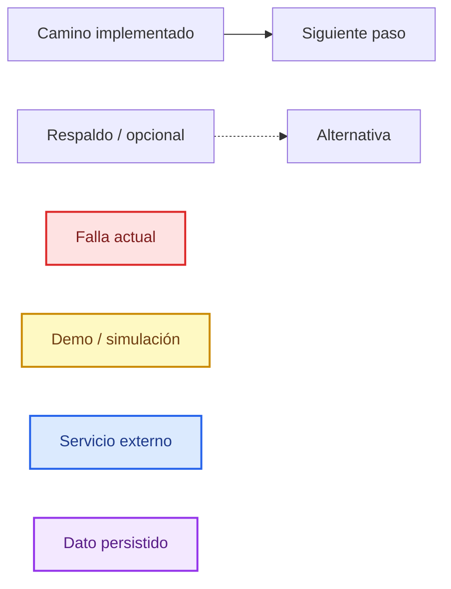

> **Importante:** los diagramas no inventan funciones ni estados intermedios. Cuando una función no existe o una llamada falla, el diagrama lo muestra como un nodo rojo y no como un camino exitoso.

---

## 2. Flujo general de extremo a extremo

Vista de conjunto: una persona puede consultar una línea, planificar un viaje o entrar a una herramienta interna. Los tres caminos comparten datos, pero tienen distinto grado de madurez.

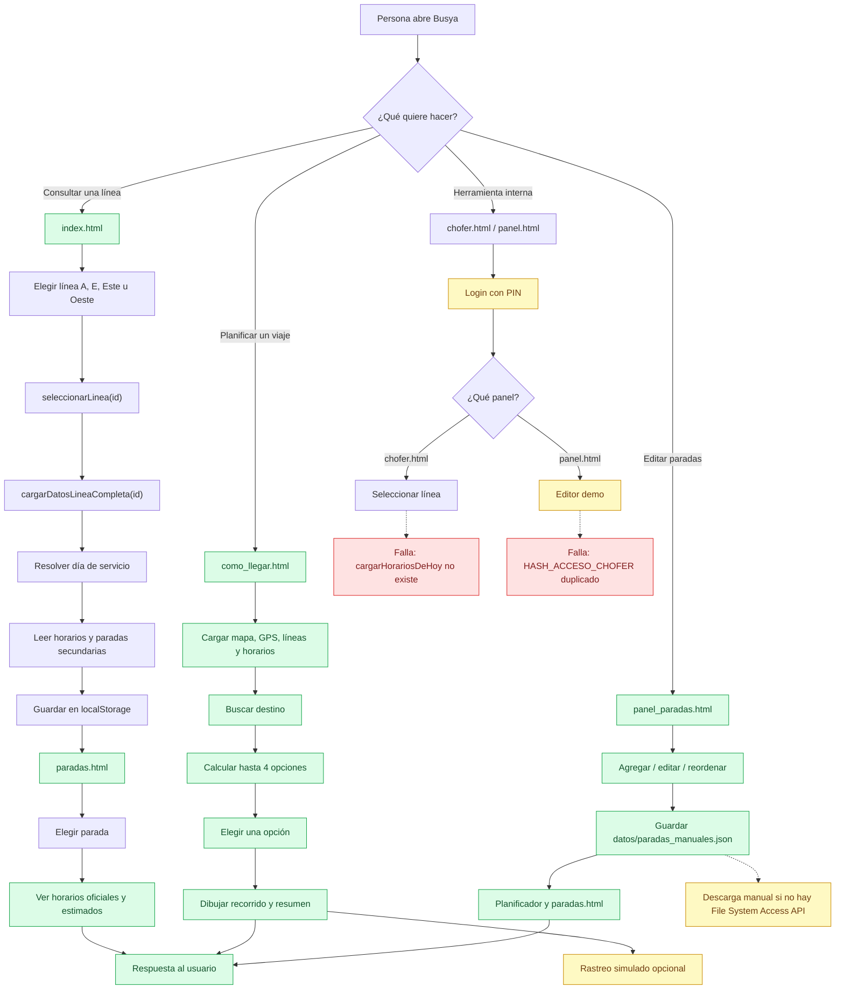

**Lectura rápida:**

- El camino `index → paradas` es el más simple y el que mejor funciona.
- El planificador calcula opciones reales, pero termina el arranque con un error no capturado (`mostrarAvisoDeOrigen`).
- Los paneles internos tienen login, pero sus flujos principales están cortados por funciones o scripts faltantes.
- El editor de paradas es el único flujo de escritura de datos: guarda `paradas_manuales.json` y alimenta al planificador y a `paradas.html`.

---

## 3. Mapa de navegación entre páginas

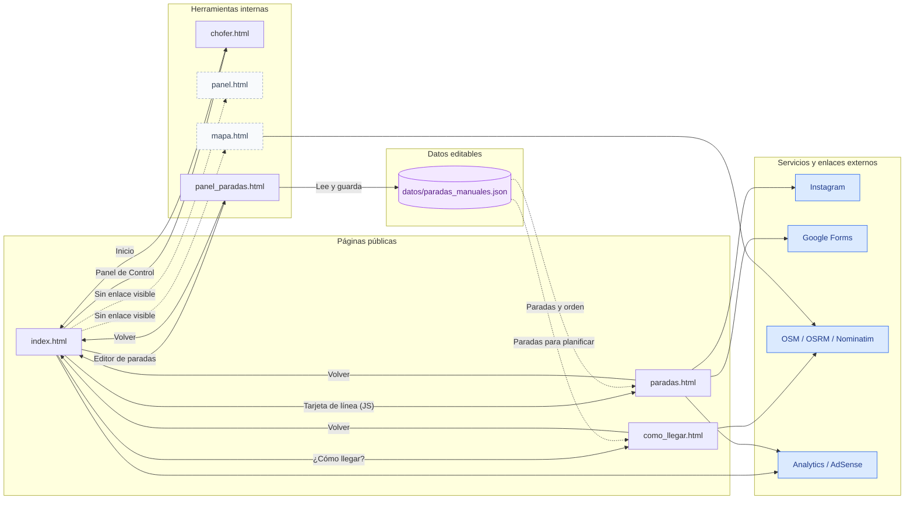

**Observaciones:**

- `mapa.html` y `panel.html` siguen siendo páginas huérfanas: no hay enlaces visibles desde el inicio.
- `panel_paradas.html` sí tiene un enlace visible en el pie de `index.html`; escribe `datos/paradas_manuales.json`.
- `paradas.html` solo funciona si se llegó desde `index.html`, porque depende de `localStorage.lineaSeleccionadaData`.
- Los enlaces externos (Instagram, formulario, mapas) no tienen fallback propio.

---

## 4. Consulta de horarios: `index.html` → `paradas.html`

Flujo principal para ver los horarios de una línea. Incluye la resolución del día, la carga de datos y el cálculo de horarios estimados en paradas intermedias.

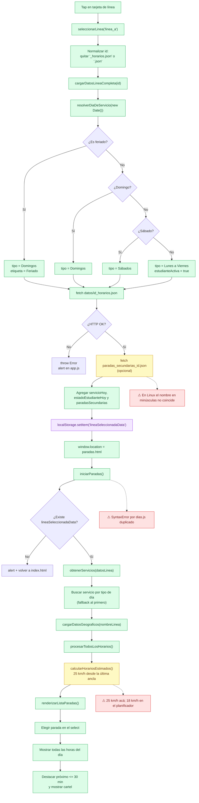

**Puntos finos:**

- La estimación de `paradas.html` usa **25 km/h** y avanza desde la última parada oficial conocida; no usa la hora real ni el recorrido de la calle.
- Los horarios estimados se distinguen con el sufijo `(estimado)`.
- `paradas.html` carga `script/dias.js` dos veces (`paradas.html:191` y `:193`). En el navegador eso produce `SyntaxError: Identifier 'RUTA_DATOS' has already been declared`; la página sigue funcionando porque el segundo script no se ejecuta.
- La búsqueda de paradas secundarias usa el nombre en minúsculas (`paradas_secundarias_linea_a.json`), mientras que el archivo real es `paradas_secundarias_Linea_A.json`. En Windows no se nota; en un servidor Linux devuelve 404 y se pierden las coordenadas.

---

## 5. Resolución del día de servicio

Este subflujo se usa en `index.html`, `paradas.html` y, de forma indirecta, en el planificador.

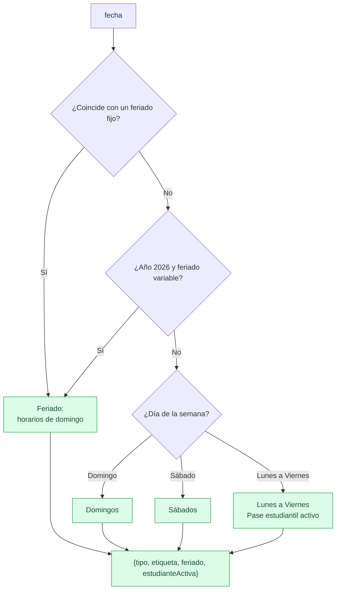

**Feriados contemplados:**

- **Fijos:** 1/1, 24/3, 2/4, 1/5, 25/5, 20/6, 9/7, 17/8, 25/8, 24/9, 12/10, 20/11, 1/12, 8/12 y 25/12.
- **Variables 2026:** 2/3, 3/3, 23/3, 2/4, 3/4 y 7/12.
- No hay tablas para feriados de otros años.

---

## 6. Arranque de `como_llegar.html`

Secuencia real de inicialización. Muestra el orden de carga, el respaldo de la API y el error final de `mostrarAvisoDeOrigen`.

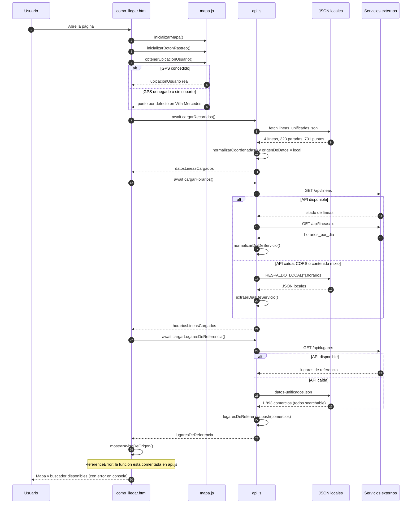

**Lectura:**

- `cargarRecorridos()` **siempre** lee el JSON local; no consulta la API.
- `cargarHorarios()` sí intenta la API y cae a los JSON si falla.
- `cargarLugaresDeReferencia()` deja los comercios en `lugaresDeReferencia`, pero el buscador no los usa después (ver §7).
- `mostrarAvisoDeOrigen()` está comentada en `api.js:379-386`, pero se invoca en `inicio.js:55`. Es el último paso del arranque y termina en error no capturado.
- `como_llegar.html` también carga `panel/main.js`, que define `cargarDatosLineas()` pero no se usa en esta página.

---

## 7. Búsqueda inteligente

Flujo del buscador de `como_llegar.html`. La búsqueda de paradas y direcciones funciona; la de comercios locales queda a mitad de camino.

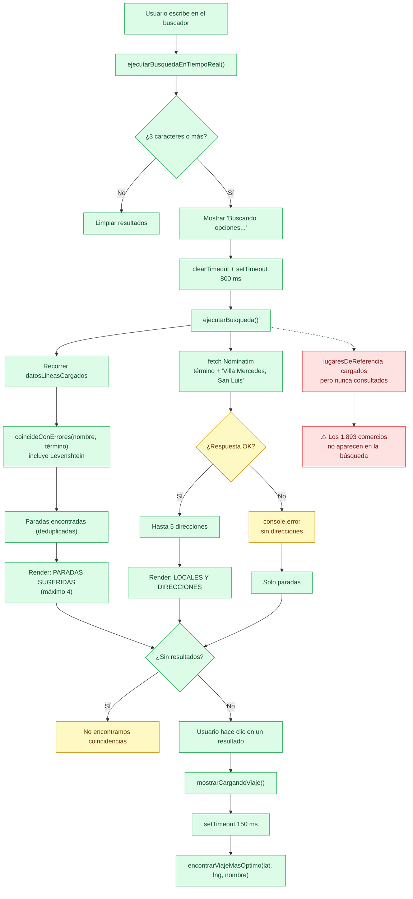

**Detalles:**

- La búsqueda de paradas tolera errores de tipeo con distancia de Levenshtein.
- Nominatim se consulta con `countrycodes=ar` y límite 5; no se filtra por bounding box de Villa Mercedes, solo por el texto agregado.
- `cargarLugaresDeReferencia()` carga los 1.893 comercios en `lugaresDeReferencia`, pero `ejecutarBusqueda()` solo recorre `datosLineasCargados` y Nominatim. Los comercios quedan como datos muertos para la búsqueda.
- La interfaz arma resultados con `innerHTML` a partir de datos de Nominatim; es un punto de riesgo de XSS (ver §14 de `DOCUMENTACION.md`).

---

## 8. Cálculo de hasta 4 opciones de viaje

Núcleo del planificador: busca orígenes, evalúa viajes directos y transbordos, deduplica y arma el modal con 2 a 4 opciones.

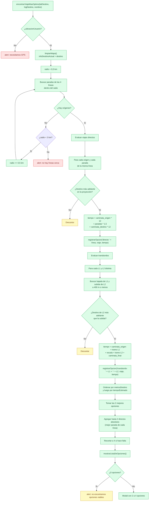

**Reglas que no se ven en el dibujo:**

- `registrarOpcion()` guarda **una sola opción por clave**: `directo-<línea>` o `transbordo-<L1>-<L2>`. Si aparece otra mejor para la misma clave, reemplaza la anterior.
- La proyección sobre la polilínea es lo que decide si una parada está “antes” o “después”; no se usa el orden del array ni la distancia en línea recta para eso.
- Los tiempos son heurísticos: **12 minutos por km caminando** y **1,5 minutos por parada** de colectivo. No usan la planilla real.
- La “fase 0” de sugerir caminar si el destino está a menos de 1 km está documentada en un comentario, pero no se implementa en este flujo.
- Si dos líneas distintas ofrecen un viaje directo, cada una puede ocupar un lugar; los directos absolutos se agregan después para asegurar que las 4 líneas tengan representación.

---

## 9. Selección de una opción y dibujo en el mapa

Secuencia al tocar una de las opciones del modal. Se separan los dos casos: viaje directo y viaje con transbordo.

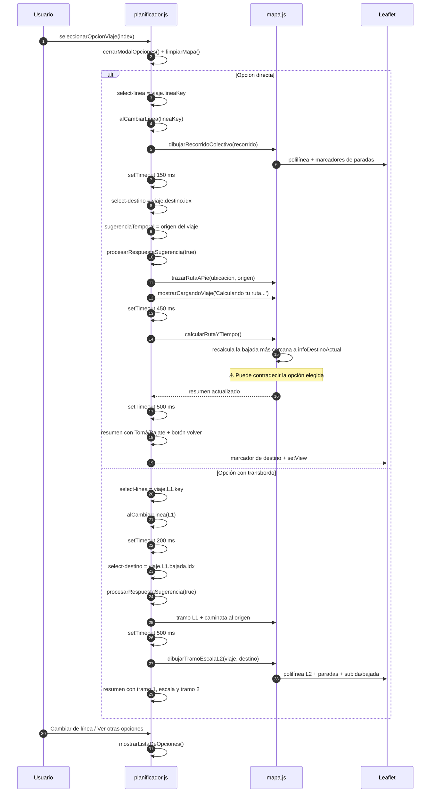

**Observaciones:**

- En el caso directo, `calcularRutaYTiempo()` vuelve a elegir la parada de bajada más cercana a `infoDestinoActual` (`mapa.js:103-124`). Eso puede cambiar la bajada que el usuario había elegido en el modal.
- El resumen se escribe dos veces: primero `calcularRutaYTiempo()` y, 500 ms después, el bloque específico de la opción. El segundo pisa al primero.
- En el transbordo se dibuja el tramo de L1, luego la escala y el tramo de L2 en otro color; el botón “Cambiar de línea / Ver otras opciones” reabre el modal.
- `limpiarMapa()` corta el simulador si estaba activo; después hay que volver a prenderlo.

---

## 10. Emparejamiento de grilla e interpolación de horarios

### 10.1 Emparejar nombres de la planilla con paradas de calle

La planilla usa nombres abreviados (“L.Guillet y G. Paz”) y las paradas de calle usan nombres completos (“León Guillet y Gral. Paz”). Este flujo arma la tabla de anclas.

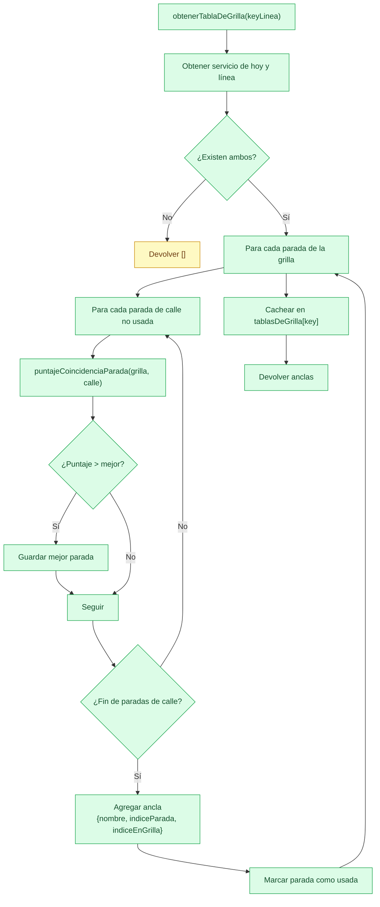

**Puntaje (0 a 100):**

1. Normaliza ambos nombres: sin acentos, minúsculas, sin puntuación.
2. Compara palabras distintivas (3 letras o más).
3. Exige que **todas** las palabras de la grilla aparezcan en la parada de calle.
4. Exige que **al menos la mitad** de las palabras de calle aparezcan en la grilla.
5. Asigna 70 a 100 según la cobertura; si no cumple, devuelve 0.

### 10.2 Interpolar la hora de una parada intermedia

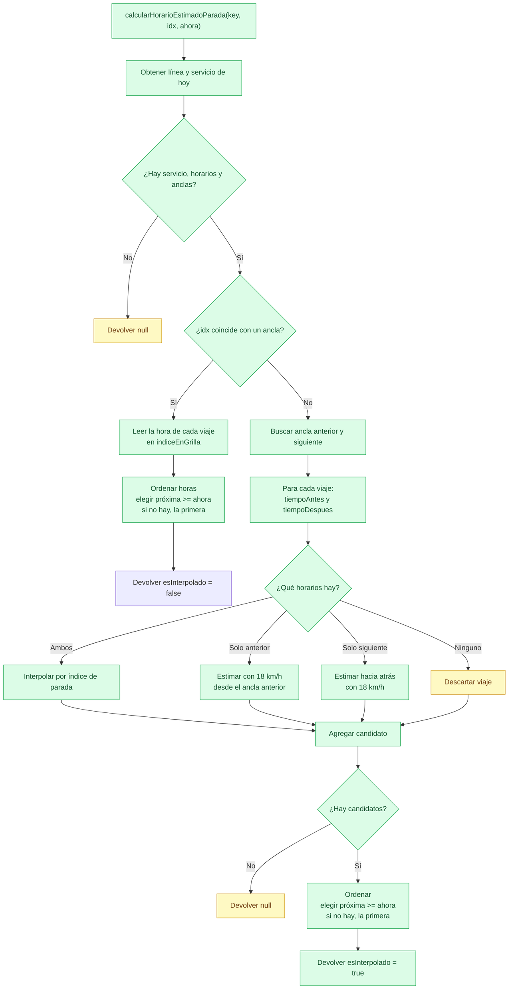

**Fórmulas:**

- **Con dos anclas:** `minutos = antes + (despues - antes) * (indiceParada - indiceAntes) / (indiceDespues - indiceAntes)`.
- **Con una sola ancla:** distancia de ruta entre paradas / 18 km/h.
- La interpolación usa el **índice de la parada** en la lista, no la distancia real entre paradas. Es una aproximación.
- `esInterpolado = true` hace que la interfaz muestre “Horario estimado” en lugar de “Horario programado”.
- La constante es **18 km/h** en `horarios.js` y `mapa.js`, pero **25 km/h** en `paradas.js`. Los tiempos no coinciden entre páginas.

---

## 11. Simulación de colectivos

El botón “Rastreo de colectivos” no usa GPS: anima los viajes de la planilla sobre el recorrido. Cada segundo recalcula posiciones y actualiza los marcadores.

### 11.1 Estados del rastreador

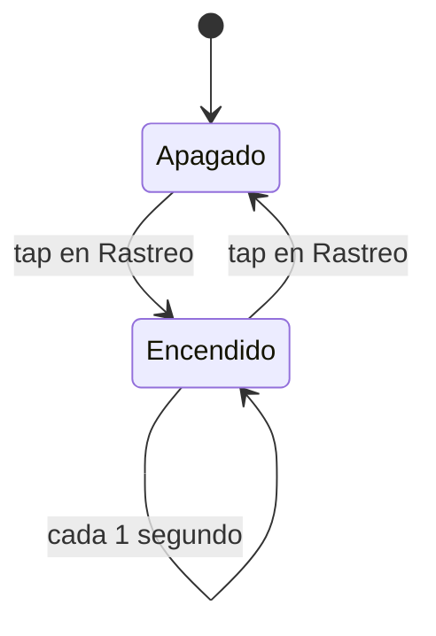

### 11.2 Cálculo de posiciones

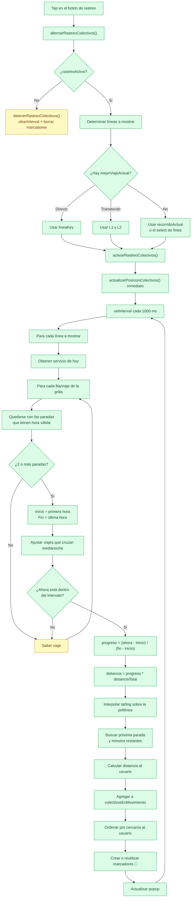

**Qué es real y qué no:**

- **Real:** las horas de la planilla, el recorrido y las paradas.
- **Simulado:** la posición del colectivo. Se obtiene repartiendo la distancia total del recorrido en proporción al tiempo transcurrido entre la primera y la última hora del viaje.
- **No hay GPS, ni internos, ni retrasos reales.** El texto “Simulando en vivo” puede confundir; el aviso de limitaciones aclara que las ubicaciones son simuladas.
- Si la planilla dice que un viaje está en curso, el colectivo aparece aunque no exista en la calle.
- Los marcadores se recrean cuando cambia la cantidad de colectivos; si no, se reutilizan y solo se mueven.

---

## 12. Panel del chofer (`chofer.html`)

Flujo de login y panel. En el estado actual, el login funciona pero la selección de línea se corta porque `cargarHorariosDeHoy()` no está definida.

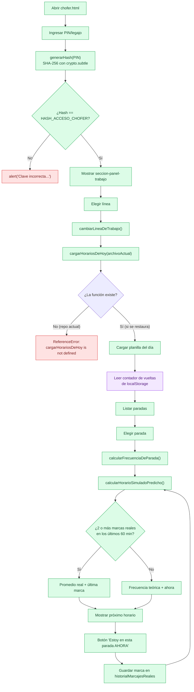

**Estado actual:**

- El PIN de demo `1234` abre el panel. El hash SHA-256 está hardcodeado en `panel/chofer.js:1`.
- Al elegir una línea, `cambiarLineaDeTrabajo()` llama a `cargarHorariosDeHoy()`; esa función **no existe** en `script/dias.js`, `panel/chofer.js` ni en ningún otro script cargado por `chofer.html`.
- El error se produce antes del `.then()`, así que el contador de vueltas y la lista de paradas nunca se inicializan.
- El flujo posterior (frecuencia, predicción, marcas) está implementado y es coherente, pero hoy es inalcanzable.
- Las marcas reales viven en memoria (`historialMarcajesReales`) y se pierden al recargar; no hay backend ni multiusuario.

---

## 13. Panel y editor demo (`panel.html`)

Flujo de login y editor experimental. El login funciona, pero el editor no se inicializa por una declaración duplicada.

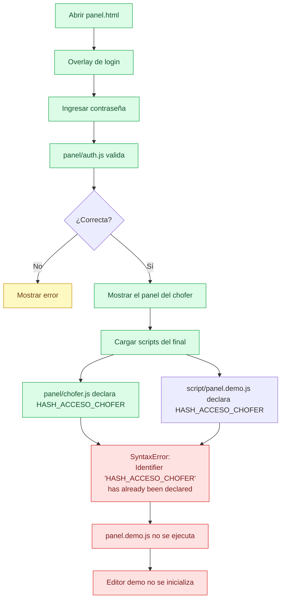

**Observaciones:**

- El login de `panel.html` acepta el PIN de demo `1234`, aunque el placeholder del formulario sugiere `5456`. Esa pista es engañosa y no debería estar en producción.
- `panel/chofer.js` y `script/panel.demo.js` declaran la misma constante global. El navegador detecta la redeclaración al cargar el segundo script y aborta su ejecución.
- `panel.html` mezcla dos implementaciones de panel: la de `panel/chofer.js` (login, frecuencia, predicción) y la de `script/panel.demo.js` (editor de horarios). La segunda queda bloqueada.
- La autenticación es 100 % cliente; cualquiera puede inspeccionar el hash y saltarla. No es seguridad real.

---

## 13.1 Editor de paradas (`panel_paradas.html`)

Flujo real de lectura, edición y guardado. Es la única parte de la aplicación que escribe un archivo de datos.

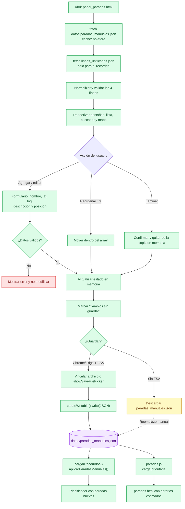

**Observaciones:**

- El listado y el mapa trabajan sobre una copia en memoria. Hasta que se guarda, `datos/paradas_manuales.json` no cambia.
- El orden del array `paradas` es el orden del recorrido. Los botones ↑/↓ y el campo “posición” mueven la parada dentro de ese array.
- El mapa permite hacer clic para fijar coordenadas y arrastrar el marcador; “Usar mi ubicación” completa latitud y longitud.
- La validación exige nombre, latitud/longitud numéricas y posición entera dentro del rango. Un archivo vinculado debe tener las cuatro líneas y todas sus paradas con nombre y coordenadas válidas; si falta una, se rechaza sin reemplazar los datos en memoria.
- En Chrome/Edge con `localhost` o HTTPS, el guardado directo escribe el archivo elegido con File System Access API. En otros casos se descarga el JSON y el usuario debe reemplazar `datos/paradas_manuales.json`.
- `cargarRecorridos()` aplica las paradas manuales después de leer `lineas_unificadas.json`; `paradas.js` las lee antes de su respaldo. Así se ven en el planificador y en la página de paradas.
- Una parada insertada antes de la primera parada oficial queda visible, pero `paradas.html` no puede estimarle un horario porque no tiene un ancla anterior.

---

## 14. Carga de datos y respaldo API/local

Flujo de `cargarRecorridos()`, `aplicarParadasManuales()`, `cargarHorarios()` y `cargarLugaresDeReferencia()`. Muestra qué se lee de la API, qué se lee de los JSON y qué queda sin usar.

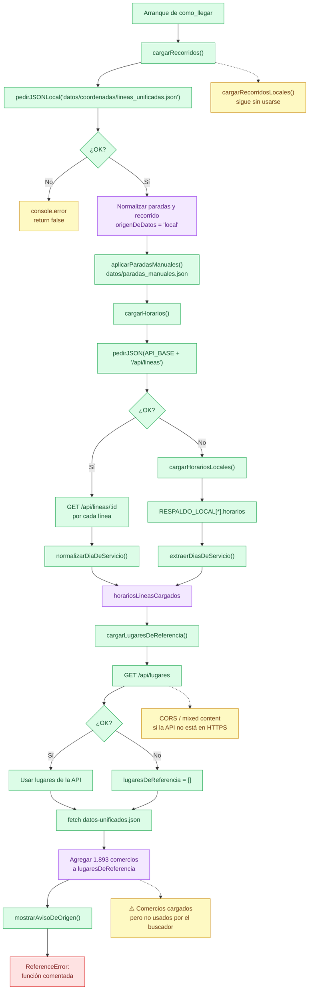

**Contrato de la API:**

| Método | Ruta | Uso |
|---|---|---|
| GET | `/api/lineas` | Listado de líneas |
| GET | `/api/lineas/:id` | Detalle con horarios, paradas y recorrido |
| GET | `/api/lugares` | Lugares de referencia |

**Matriz de respaldo:**

| Dato | Fuente primaria | Respaldo | Estado |
|---|---|---|---|
| Paradas y recorridos | `lineas_unificadas.json` + `paradas_manuales.json` | `paradas_secundarias_Linea_<X>.json` en `paradas.html` | `cargarRecorridos()` siempre usa local; las paradas manuales reemplazan a las de `lineas_unificadas.json` |
| Horarios | API `/api/lineas` | `RESPALDO_LOCAL` | Funciona con y sin API |
| Lugares de referencia | API `/api/lugares` | — | Sin API quedan vacíos; los 6 `lugares_de_referencia` locales no se leen |
| Comercios | `datos-unificados.json` | — | Se cargan, pero el buscador no los consulta |

**Deuda asociada:**

- `API_BASE` está hardcodeado a `http://localhost:3000`.
- Si la app se sirve por HTTPS, la API HTTP se bloquea por contenido mixto.
- `cargarRecorridosLocales()` sigue sin usarse; `aplicarParadasManuales()` se llama desde `cargarRecorridos()` y depende de que `datos/paradas_manuales.json` exista.
- `cargarLugaresDeReferencia()` está definida dos veces en `api.js`; la segunda pisa a la primera.
- `mostrarAvisoDeOrigen()` está comentada y se invoca igual.

---

## 15. Prueba de la fuente real (`prueba.js`)

Prueba aislada de la fuente de colectivoya. **No está integrada a la aplicación** y no se sirve desde el navegador: es un script de Node.js.

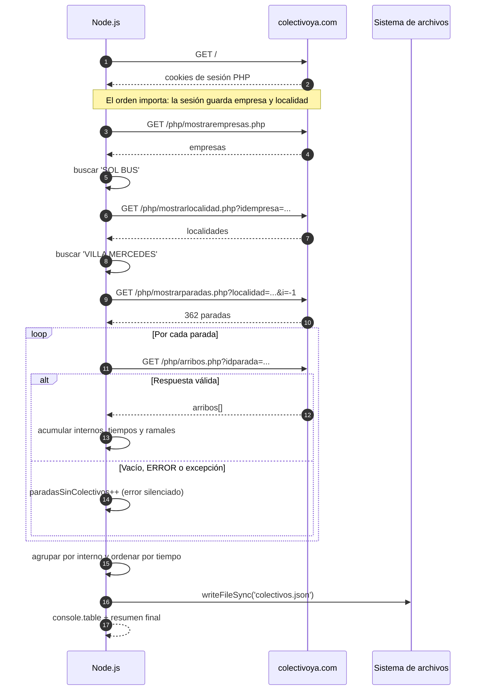

**Lectura:**

- El script consulta **362 paradas** una atrás de otra, sin pausa ni caché. Sirve para probar, no para producción.
- El orden de los pedidos no es opcional: `mostrarempresas.php` y `mostrarlocalidad.php` dejan la empresa y la localidad en la sesión PHP. Si se llama a `mostrarparadas.php` sin esa sesión, devuelve una lista vacía sin error.
- Los errores de cada parada se cuentan como “sin colectivos”; no se distingue “no hay” de “no pude consultar”.
- No se filtra `distancia > 0` ni se valida que las coordenadas sean útiles.
- La fuente es HTTP y no permite CORS; el scraper debe correr del lado del servidor (función serverless o backend con caché).
- El resultado se guarda en `colectivos.json`; ese archivo no se usa en la app actual.

---

## 16. Mapa de calor (`mapa.html`)

Página de mapa por línea con puntos coloreados según la cercanía del próximo paso. El script está ofuscado y la página falla al elegir una línea.

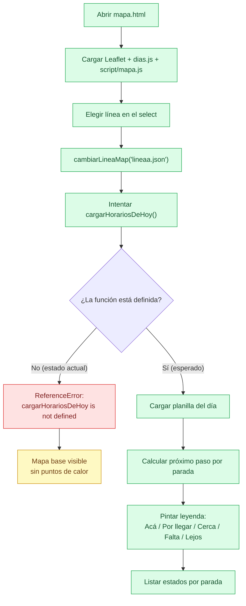

**Detalles:**

- La página carga el mapa de Leaflet, pero no puede pintar el estado de las paradas porque `script/mapa.js` espera `cargarHorariosDeHoy()` y esa función no está en el HTML.
- El archivo `script/mapa.js` está minificado/ofuscado; no es auditable en el repositorio.
- La leyenda muestra cinco estados: “Acá”, “Por llegar”, “Cerca”, “Falta” y “Lejos”.
- `mapa.html` no está enlazada desde el inicio; se llega solo por URL directa.

---

## 17. Resumen de estado por flujo

| Flujo | Estado | Dónde se corta | Diagrama |
|---|---|---|---|
| Inicio → elegir línea → paradas | ⚠️ Funciona con error | `SyntaxError` por `dias.js` duplicado; la página sigue | §4 |
| Resolución de día y feriados | ✅ | — | §5 |
| Arranque del planificador | ⚠️ Funciona con error | `mostrarAvisoDeOrigen` no definida | §6 |
| Búsqueda de paradas y direcciones | ✅ | — | §7 |
| Búsqueda de comercios locales | ❌ | `lugaresDeReferencia` no se consulta | §7 |
| Cálculo de 2 a 4 opciones | ✅ | — | §8 |
| Selección de opción y resumen | ⚠️ | La bajada se reemplaza por la más cercana al destino | §9 |
| Interpolación de horarios | ✅ | — | §10 |
| Simulación de colectivos | ⚠️ demo | Es una animación, no GPS real | §11 |
| Panel del chofer | ❌ | `cargarHorariosDeHoy` no existe | §12 |
| Panel/editor demo | ❌ | `HASH_ACCESO_CHOFER` duplicado | §13 |
| Editor de paradas | ✅ | Guardado directo solo en Chrome/Edge con FSA; en otros navegadores descarga el JSON | §13.1 |
| Respaldo API/local | ✅ | API hardcodeada a `localhost:3000` | §14 |
| Fuente real `prueba.js` | ⚠️ POC | No integrada; errores silenciados | §15 |
| Mapa de calor | ❌ | `cargarHorariosDeHoy` no existe | §16 |

---

## 18. Cómo renderizar los diagramas

Los bloques están en **Mermaid**, un formato de texto que se renderiza en muchos visores.

### GitHub y GitLab

- GitHub renderiza Mermaid de forma nativa en archivos `.md`.
- GitLab también lo soporta en Markdown, según la versión y la configuración del proyecto.
- Si el visor no lo renderiza, se verá el bloque de código, no una imagen rota.

### Visual Studio Code

Instalar la extensión **Markdown Preview Mermaid Support** y abrir la vista previa del Markdown:

```text
Ctrl+Shift+V
```

### Editor en línea

1. Abrir <https://mermaid.live/>.
2. Copiar el contenido que está entre las marcas de apertura y cierre de un bloque Mermaid (sin incluir esas marcas).
3. Pegarlo en el editor y exportar SVG o PNG.

### Línea de comandos

Para convertir un diagrama puntual:

1. Guardar el contenido en `diagrama.mmd`.
2. Ejecutar:

```bash
npx -y @mermaid-js/mermaid-cli -i diagrama.mmd -o diagrama.svg
```

Para exportar a PNG:

```bash
npx -y @mermaid-js/mermaid-cli -i diagrama.mmd -o diagrama.png -w 1600
```

> **Nota:** `mermaid-cli` instala un navegador headless la primera vez. Si no hay red o el entorno lo bloquea, usar el editor en línea.

### Consejos de compatibilidad

- No cambiar los identificadores de nodo (`A`, `B`, `P1`, etc.) sin motivo: las clases de color los referencian.
- Evitar agregar HTML complejo dentro de los nodos; `<br/>` es suficiente.
- Si un visor usa una versión vieja de Mermaid, los diagramas de secuencia y los `stateDiagram-v2` pueden no renderizarse. En ese caso, actualizar el visor o usar mermaid.live.

---

## 19. Mantenimiento de este documento

Este archivo es documentación viva. Conviene actualizarlo cuando cambie alguno de estos puntos:

1. **Se restaure `cargarHorariosDeHoy()`** en `chofer.html` o se cargue el módulo que la provee: actualizar §12 y §17.
2. **Se conecten los comercios** al buscador: actualizar §7, §14 y §17.
3. **Se corrija `mapa.html`**: actualizar §16 y §17.
4. **Se separe `panel.html`** del panel del chofer: actualizar §13.
5. **Se cambie el formato o la ubicación de `paradas_manuales.json`**, o se agregue autenticación al editor: actualizar §13.1 y §14.
6. **Se integre el GPS real** de colectivoya: reemplazar la simulación de §11 por un flujo de datos en vivo y actualizar el aviso de limitaciones.
7. **Se unifiquen las velocidades** (18 vs 25 km/h): actualizar §10.
8. **Se cambie la API** o se configure por entorno: actualizar §14.

### Reglas para no desactualizar los diagramas

- Si se agrega una función, agregar el nodo y el archivo donde vive.
- Si se elimina una función, borrar el nodo y las aristas que la usan.
- Si una falla se corrige, cambiar el nodo rojo por uno verde y anotar la fecha.
- Si un flujo es demo, mantenerlo amarillo y aclararlo en el texto.

---

## Referencias

- [`DOCUMENTACION.md`](DOCUMENTACION.md) — documentación técnica y funcional completa.
- [`VISION.md`](VISION.md) — principios de producto y límites de lo que Busya debe ser.
- [`DOCUMENTACION_CAMBIOS.md`](DOCUMENTACION_CAMBIOS.md) — detalle del cambio de 3 a 4 opciones en el planificador.
- `script/como_llegar/planificador.js` — búsqueda y cálculo de opciones.
- `script/como_llegar/horarios.js` — anclas, interpolación y servicio del día.
- `script/como_llegar/simulador.js` — animación de colectivos.
- `script/como_llegar/api.js` — carga de datos y respaldo.
- `script/dias.js` — día de servicio, feriados y carga de línea.
- `panel/chofer.js` — login, frecuencia y predicción del chofer.
- `prueba.js` — prueba de la fuente real de colectivoya.
