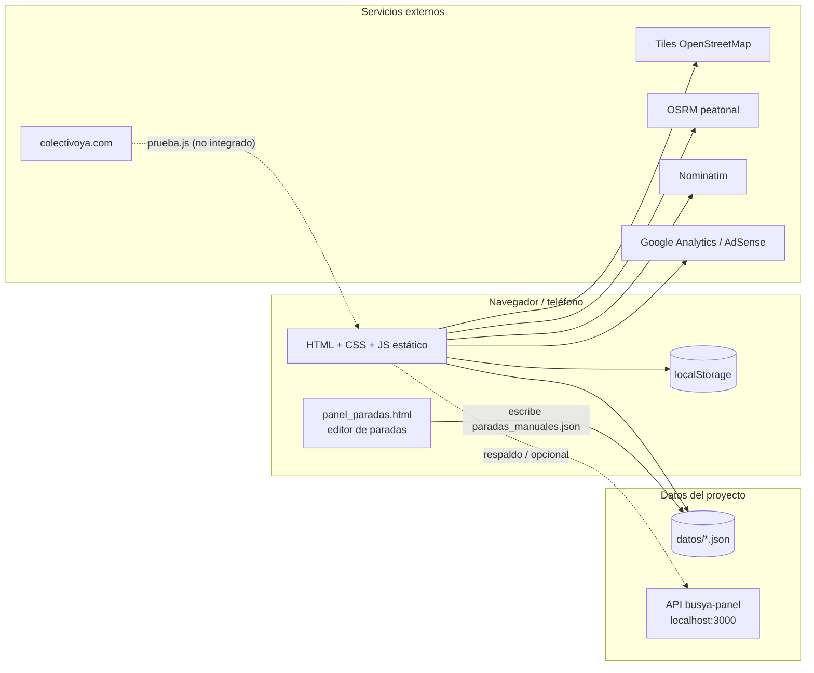
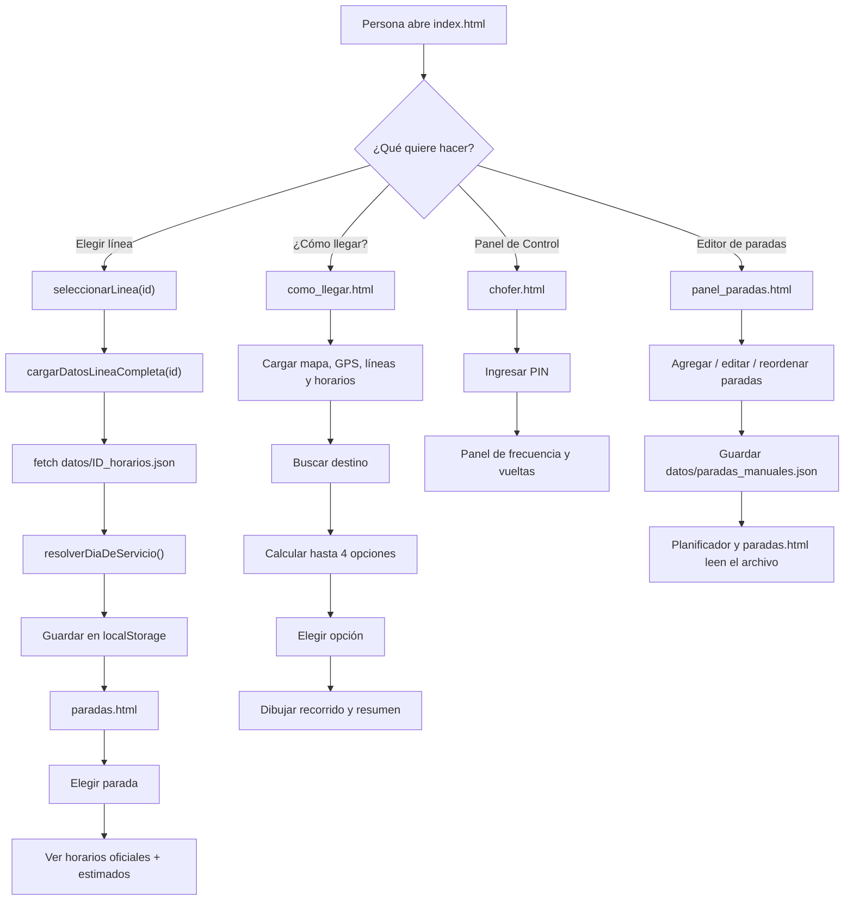
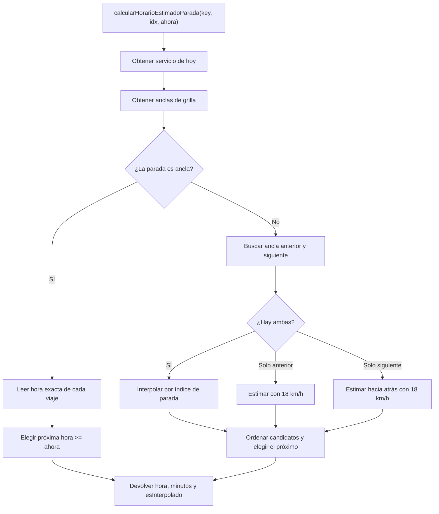
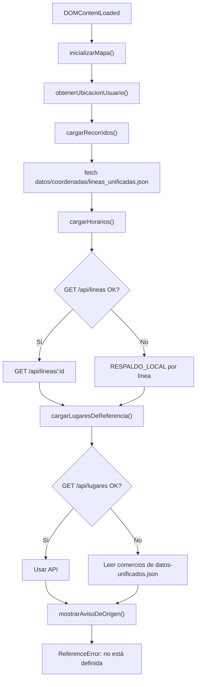

# Busya — Documentación técnica y funcional

> **Proyecto:** Busya — información de colectivos de Villa Mercedes (Solbus)
> **Versión documentada:** V14 (`index.html`)
> **Fecha de relevamiento:** 28/10/2026
> **Alcance:** código, datos, páginas y comportamiento observado en el repositorio local
> **Documentos relacionados:** [`VISION.md`](VISION.md), [`DOCUMENTACION_CAMBIOS.md`](DOCUMENTACION_CAMBIOS.md), [`DIAGRAMA_FLUJO.md`](DIAGRAMA_FLUJO.md)

---

## 1. Resumen ejecutivo

Busya es una aplicación **web estática, mobile-first**, que muestra horarios, recorridos y una estimación de paso de los colectivos de Solbus en Villa Mercedes. Está pensada para abrirse en el teléfono, parado en la parada, y responder rápido: qué línea conviene, a qué hora pasa y cuánto falta.

El proyecto tiene hoy cuatro líneas cargadas (A, E, Zona Este y Zona Oeste), **323 paradas** con coordenadas, **339 viajes semanales** de planilla y un buscador de paradas y direcciones. El dataset incluye **1.893 comercios**, pero el buscador actual todavía no los consulta: se cargan en memoria y quedan sin uso (ver §6.3).

Desde el 28/10/2026 también existe **`panel_paradas.html`**, un editor visual para agregar, editar y reordenar paradas sin tocar el JSON a mano. Guarda sobre `datos/paradas_manuales.json`, que es la fuente canónica de paradas y orden de recorrido; el planificador y `paradas.html` leen ese archivo.

La arquitectura es deliberadamente simple:

- **Front estático:** HTML + CSS + JavaScript clásico, sin framework ni build.
- **Datos en JSON** dentro del repositorio (`datos/`).
- **Sin base de datos de usuarios**, sin login de pasajeros y sin backend propio en este repo.
- **API opcional** (`http://localhost:3000`) con respaldo automático a los JSON locales.
- **Leaflet + OpenStreetMap** para mapas, **OSRM** para rutas peatonales y **Nominatim** para direcciones.
- **Simulación** de colectivos sobre la grilla horaria; el GPS real todavía no está integrado.

> **Estado real:** es un MVP funcional de consulta y planificación. La fuente de tiempo real existe y fue verificada en `prueba.js`, pero **no está conectada a la aplicación**. Lo que se ve en el mapa como “rastreo” es una simulación basada en la planilla, y la propia app lo aclara en el aviso de limitaciones.

### Números clave

| Indicador | Valor | Fuente |
|---|---:|---|
| Líneas | 4 | `datos/coordenadas/lineas_unificadas.json` |
| Paradas con coordenadas | 323 | 90 A + 76 E + 59 Este + 98 Oeste |
| Puntos de recorrido | 701 | 241 A + 147 E + 172 Este + 141 Oeste |
| Viajes semanales de planilla | 339 | 120 A + 136 E + 57 Este + 26 Oeste |
| Comercios en el dataset | 1.893 | `datos/datos-unificados.json` (cargados, no consultados por el buscador) |
| Lugares de referencia | 6 | `datos/datos-unificados.json` (no leídos por el código actual) |
| Tiles offline | 504 PNG | `tiles/` (no usados por el código actual) |
| Archivos del proyecto (sin tiles) | 85 | relevamiento local |

---

## 2. Qué hace hoy y qué no

### 2.1 Funcionalidades implementadas

| Funcionalidad | Estado | Dónde |
|---|---|---|
| Elegir línea y ver paradas | ⚠️ | `index.html` → `paradas.html` (funciona, pero registra un `SyntaxError` benigno por `dias.js` duplicado) |
| Agregar, editar y reordenar paradas sin editar JSON | ✅ | `panel_paradas.html`, `script/panel_paradas.js`, `datos/paradas_manuales.json` |
| Horarios por día (semana/sábado/domingo/feriado) | ✅ | `script/dias.js`, `datos/*_horarios.json` |
| Horarios estimados en paradas intermedias | ✅ | `script/paradas.js`, `script/como_llegar/horarios.js` |
| Buscador de paradas con tolerancia a errores | ✅ | `script/como_llegar/utilidades.js`, `planificador.js` |
| Buscador de direcciones | ✅ | Nominatim |
| Buscador de comercios locales | ⚠️ | `datos-unificados.json` se carga, pero `ejecutarBusqueda()` no lee `lugaresDeReferencia` |
| Planificador directo y con transbordo | ✅ | `script/como_llegar/planificador.js` |
| Mapa de recorrido y paradas | ✅ | `script/como_llegar/mapa.js` |
| Ruta a pie hasta la parada | ✅ | OSRM peatonal |
| Simulación de colectivos sobre la planilla | ✅ | `script/como_llegar/simulador.js` |
| Mapa de calor por cercanía horaria | ⚠️ | `mapa.html` (falla al elegir línea, ver §13) |
| Panel de chofer con frecuencia y predicción | ⚠️ demo | `chofer.html`, `panel/chofer.js` (login OK; al elegir línea falta `cargarHorariosDeHoy`) |
| Editor de horarios en modo demo | ⚠️ | `panel.html` (falla por scripts duplicados) |
| Pase estudiantil según día | ✅ | `script/dias.js`, `script/app.js` |
| Reportes de pasajeros (“¿Ya pasó?”) | ❌ | No implementado |
| GPS real de colectivos | ❌ | Solo prueba aislada en `prueba.js` |
| Puntos de recarga | ❌ | No implementado |
| App instalable (PWA) | ❌ | Sin manifest ni service worker |

### 2.2 Lo que la app declara que es simulado

`index.html` muestra un aviso de limitaciones la primera vez (`localStorage.avisoBusyaVisto`) que dice, entre otras cosas:

- faltan lugares y paradas;
- **los horarios y ubicaciones del mapa son simulados**, porque no hay acceso al GPS real;
- las rutas y transbordos pueden ser inexactos.

Ese aviso es coherente con el principio de `VISION.md`: **nunca mentir sobre lo que sabemos**. La deuda pendiente es que el botón del planificador se llama “Rastreo de colectivos” y el estado dice “Simulando en vivo”; conviene reforzar visualmente que no es GPS real.

---

## 3. Usuarios y casos de uso

| Usuario | Necesidad | Cobertura actual |
|---|---|---|
| Persona esperando en la parada | Cuánto falta, ahora, sin tocar nada | Parcial: requiere elegir línea o buscar; no abre “ya contestada” |
| Persona planificando desde casa | A qué hora salir | Buena: horarios y planificador |
| Persona que no conoce las líneas | Qué colectivo la lleva | Buena: buscador inteligente con 4 opciones |
| Estudiantes | Si rige el pase hoy | Buena: estado por día y feriado |
| Choferes / empresa | Frecuencia real y datos de servicio | Demo local, sin persistencia real |
| Equipo / administrador de datos | Agregar o corregir paradas sin editar JSON | `panel_paradas.html` + `datos/paradas_manuales.json` |
| Pasajeros en paradas sin GPS | Confirmar si el colectivo pasó | No implementado |

**Usuario principal según la visión:** el que ya está en la parada, apurado, con una mano y sol en la pantalla. Las decisiones de diseño deben favorecer ese caso.

---

## 4. Arquitectura

### 4.1 Vista general



### 4.2 Principios de diseño vigentes

1. **El front es estático.** No hay framework, bundler ni servidor de aplicación en este repositorio.
2. **Los datos viven en JSON.** Horarios, paradas y recorridos se calculan una vez y se guardan.
3. **La planilla es el piso, el GPS es una capa.** Si no hay datos en vivo, la app debe seguir respondiendo con la grilla.
4. **No hay cuentas de pasajero.** La ubicación se usa en el teléfono y no se persiste.
5. **No se venden boletos, no hay red social, no hay app nativa.** Ver `VISION.md`.
6. **La app no debe quedar vacía por falta de GPS.** Hoy se cumple porque todo se calcula desde la planilla.

### 4.3 Estilo de código

- Scripts clásicos (`<script src="...">`), **no módulos ES**. Las variables globales se comparten entre archivos.
- `como_llegar.html` está partido en 8 archivos numerados del 1 al 8; el orden de carga importa.
- Los nombres de funciones y variables están en español.
- Los datos usan `lat`/`lng`; algunos archivos heredados traen `lon`. El código tolera ambos.
- No hay `package.json`, linter, tests ni pipeline de CI.

---

## 5. Estructura del repositorio

```text
busya/
├── index.html                 # Inicio: elección de línea y accesos
├── paradas.html               # Paradas y horarios de una línea
├── como_llegar.html           # Buscador + planificador + mapa
├── mapa.html                  # Mapa de calor por línea
├── chofer.html                # Login y panel del chofer
├── panel.html                 # Login y panel/editor experimental
├── panel_paradas.html         # Editor visual de paradas (CRUD + orden)
├── prueba.js                  # Prueba de la fuente real (Node, no se sirve)
├── VISION.md                  # Documento de producto
├── DOCUMENTACION_CAMBIOS.md   # Cambios del planificador (4 opciones)
├── autobus-escolar.ico
│
├── script/
│   ├── dias.js                # Día de servicio, feriados, carga de línea
│   ├── app.js                 # seleccionarLinea() + modal estudiantil
│   ├── paradas.js             # Lógica de paradas.html
│   ├── panel_paradas.js       # Lógica del editor visual de paradas
│   ├── mapa.js                # Mapa de calor (ofuscado)
│   ├── chofer.js              # Copia duplicada de panel/chofer.js
│   ├── panel.demo.js          # Editor demo de horarios
│   └── como_llegar/
│       ├── estado.js          # 1/8 · estado global
│       ├── utilidades.js      # 2/8 · matemática y texto
│       ├── api.js             # 3/8 · carga de datos + respaldo
│       ├── horarios.js        # 4/8 · grilla e interpolación
│       ├── mapa.js            # 5/8 · Leaflet, GPS, rutas
│       ├── planificador.js    # 6/8 · búsqueda y mejor viaje
│       ├── simulador.js       # 7/8 · colectivos simulados
│       ├── inicio.js          # 8/8 · arranque
│       ├── planificador copy 2.js   # legado
│       └── planificador feito.js    # legado
│
├── panel/
│   ├── main.js                # carga de los 4 JSON de horarios
│   ├── auth.js                # autenticación de panel.html (ofuscado)
│   ├── chofer.js              # panel de chofer (hash + frecuencia)
│   ├── editor.js              # editor de horarios (ofuscado)
│   └── gps.js                 # estimación GPS (ofuscado)
│
├── datos/                     # FUENTE DE VERDAD ACTUAL
│   ├── linea_a_horarios.json
│   ├── linea_e_horarios.json
│   ├── linea_este_horarios.json
│   ├── linea_oeste_horarios.json
│   ├── paradas_manuales.json  # fuente canónica de paradas y orden
│   ├── datos-unificados.json
│   └── coordenadas/
│       ├── lineas_unificadas.json
│       ├── paradas_secundarias_Linea_A.json
│       ├── paradas_secundarias_Linea_E.json
│       ├── paradas_secundarias_Linea_Este.json
│       ├── paradas_secundarias_Linea_Oeste.json
│       ├── cordenadas.json
│       └── cordenadas_e.txt
│
├── data/                      # Datos originales / legado
│   └── recorridos_originales/ … (líneas A, E, Este, Oeste y findes)
│
├── estilos/
│   ├── style.css
│   ├── style copy.css         # legado
│   ├── style_panel.css
│   ├── panel_paradas.css      # Estilos del editor de paradas
│   └── img/ (logo.jpeg, instagram.png)
│
└── tiles/                     # 504 tiles OSM offline (no referenciados)
```

### 5.1 Páginas y scripts que carga cada una

| Página | Scripts principales | Estado |
|---|---|---|
| `index.html` | `script/dias.js`, `script/app.js` | ✅ |
| `paradas.html` | `script/dias.js` (2 veces), `script/paradas.js` | ⚠️ error por duplicado |
| `como_llegar.html` | `dias.js` + los 8 de `como_llegar/` + `panel/main.js` | ✅ con error final |
| `mapa.html` | `script/dias.js`, `script/mapa.js` | ⚠️ falla al elegir línea |
| `chofer.html` | `script/dias.js`, `panel/chofer.js` | ⚠️ login OK; elegir línea falla |
| `panel.html` | `panel/main.js`, `auth.js`, `chofer.js`, `dias.js`, `panel.demo.js`, `app.js` | ⚠️ editor roto |
| `panel_paradas.html` | `script/panel_paradas.js`, Leaflet 1.9.4 | ✅ |

---

## 6. Páginas y funcionalidad

### 6.1 `index.html` — Inicio

**Propósito:** elegir una línea o entrar al planificador.

- Cuatro tarjetas: Línea A, Línea E, Zona Este y Zona Oeste.
- Botón “¿Cómo llegar?” que abre `como_llegar.html`.
- Footer “⚙️ Panel de Control” que abre `chofer.html`.
- Botones flotantes: aviso de limitaciones, pase estudiantil, Instagram y formulario de críticas.
- Modal de limitaciones que se muestra una sola vez (`localStorage.avisoBusyaVisto`).

**Flujo al elegir una línea:**

1. `seleccionarLinea('linea_a')` en `script/app.js`.
2. `cargarDatosLineaCompleta('linea_a')` en `script/dias.js`:
   - resuelve el día de servicio (incluye feriados);
   - lee `datos/linea_a_horarios.json`;
   - intenta leer `datos/coordenadas/paradas_secundarias_linea_a.json`.
3. Guarda todo en `localStorage.lineaSeleccionadaData`.
4. Redirige a `paradas.html`.

**Observación:** el inicio **no** usa GPS ni muestra la parada más cercana; esa parte de la visión (“cero toques”) todavía no está implementada. Tampoco hay enlaces visibles a `mapa.html` ni a `panel.html`.

### 6.2 `paradas.html` — Paradas y horarios

**Propósito:** elegir una parada de la línea activa y ver todos sus horarios del día.

Flujo:

1. Lee `localStorage.lineaSeleccionadaData`; si no existe, vuelve a `index.html`.
2. Resuelve el servicio de hoy (`servicioHoy`) y toma la grilla correspondiente.
3. Carga las paradas de `datos/paradas_manuales.json`; si no puede, usa como respaldo `datos/coordenadas/paradas_secundarias_Linea_<X>.json`.
4. Procesa los horarios oficiales de la grilla.
5. Calcula horarios estimados para las paradas que no están en la grilla:
   - parte de la última parada oficial conocida;
   - avanza a **25 km/h**;
   - marca la hora con `(estimado)`.
6. Renderiza el `<select>` de paradas y, al elegir una, todas las horas del día.
7. Destaca el próximo horario (si falta 30 minutos o menos) y muestra un cartel de recomendación con minutos restantes.

**Detalles:**

- La estimación se hace por distancia en línea recta entre paradas consecutivas, no por recorrido real.
- Las paradas agregadas desde `panel_paradas.html` aparecen en el selector y reciben horarios estimados si están después de una parada oficial.
- Si una parada está antes de la primera parada oficial, no recibe estimación.
- La página incluye dos veces `script/dias.js` y dos modales con `id="modal-estudiante"`, lo que produce un `SyntaxError` por redeclaración de `RUTA_DATOS` y HTML duplicado.

### 6.3 `como_llegar.html` — Planificador

**Propósito:** buscar un destino y calcular la mejor forma de llegar en colectivo, con caminata, espera y transbordos.

Componentes:

- buscador de lugares/paradas;
- selectores de línea, destino y origen;
- mapa Leaflet;
- botón “Expandir mapa”;
- botón “Rastreo de colectivos” (simulación);
- panel de resumen del viaje;
- modal de sugerencia de parada cercana.

**Carga inicial** (`inicio.js`):

1. `inicializarMapa()`.
2. `inicializarBotonRastreo()`.
3. `obtenerUbicacionUsuario()` — pide GPS; si se niega, usa un punto por defecto en Villa Mercedes.
4. `await cargarRecorridos()` — lee `datos/coordenadas/lineas_unificadas.json` y después aplica `datos/paradas_manuales.json` con `aplicarParadasManuales()`.
5. `await cargarHorarios()` — intenta la API y cae a los JSON locales.
6. `await cargarLugaresDeReferencia()` — intenta la API y suma los comercios de `datos-unificados.json`.
7. `mostrarAvisoDeOrigen()` — **la función está comentada en `api.js`, por lo que se produce un `ReferenceError`**.

**Búsqueda inteligente:**

- Se dispara a partir de 3 caracteres, con debounce de 800 ms.
- Busca en las 4 líneas con coincidencia exacta y Levenshtein (tolera errores de tipeo).
- Consulta Nominatim para direcciones dentro de Villa Mercedes.
- Muestra resultados agrupados en “Paradas sugeridas” y “Locales y direcciones”.
- **No consulta los 1.893 comercios de `datos-unificados.json`**: `cargarLugaresDeReferencia()` los deja en `lugaresDeReferencia`, pero `ejecutarBusqueda()` nunca lee ese arreglo. Solo aparecerán si Nominatim los encuentra por nombre.
- Al hacer clic, llama a `encontrarViajeMasOptimo(lat, lng, nombre)`.

**Cálculo de opciones:**

1. Busca paradas de origen en anillos de 0,5 km hasta 3 km.
2. Proyecta cada parada sobre el recorrido para saber su posición real.
3. Evalúa viajes directos: destino debe estar más adelante en el recorrido.
4. Evalúa transbordos: bajada de L1 y subida de L2 a ≤ 400 m; destino de L2 más adelante.
5. Deduplica por clave de línea/transbordo y ordena por:
   - metros caminando al destino;
   - tiempo estimado.
6. Toma las **2 mejores opciones generales**.
7. Agrega hasta **2 opciones directas absolutas** (la parada de cada línea que deje más cerca del destino), evitando duplicados.
8. Muestra un modal con **hasta 4 opciones**.

**Tiempos usados por el planificador:**

- 12 minutos por km caminando.
- 1,5 minutos por parada de colectivo.
- No usa la hora real de la planilla para el cálculo de la opción; es una heurística.

**Al seleccionar una opción:**

- Directa: configura línea, destino y origen; dibuja el tramo; muestra el resumen.
- Con transbordo: dibuja el tramo 1, la escala y el tramo 2 en otro color.
- Permite volver al modal con “Cambiar de línea / Ver otras opciones”.

**Resumen final** (`calcularRutaYTiempo`):

- caminata al origen: `distanciaAPieKm / 5 * 60`, mínimo 1 minuto;
- colectivo: `distancia del tramo / 18 * 60`, mínimo 2 minutos;
- espera: diferencia entre el próximo horario estimado y ahora;
- total: caminata + espera + colectivo.

**Observación:** si el usuario buscó un destino por nombre, `calcularRutaYTiempo` reemplaza la parada de bajada elegida por la parada más cercana a ese destino (`script/como_llegar/mapa.js:103-124`). Esto puede contradecir la opción que el usuario seleccionó.

### 6.4 `mapa.html` — Mapa de calor

**Propósito:** mostrar el recorrido de una línea y pintar cada parada según qué tan cerca está el próximo paso: “Acá”, “Por llegar”, “Cerca”, “Falta” o “Lejos”.

- Carga `script/dias.js` y `script/mapa.js` (ofuscado).
- El selector de línea llama a `cambiarLineaMap('lineaa.json')`.
- La lógica interna está ofuscada y no es auditable en el repo.
- **Falla al elegir una línea** con `ReferenceError: cargarHorariosDeHoy is not defined`; la página carga el mapa, pero no puede dibujar el estado de las paradas. Ver §13.

### 6.5 `chofer.html` — Panel del chofer

**Propósito:** herramienta interna para que un chofer registre vueltas, consulte la frecuencia de una parada y vea una predicción del próximo paso.

Flujo:

1. Ingresa un PIN/legajo.
2. `verificarIdentidad()` calcula SHA-256 en el navegador y lo compara con `HASH_ACCESO_CHOFER` (`panel/chofer.js:1`).
3. Si coincide, muestra el panel.
4. Al elegir la línea, `cambiarLineaDeTrabajo()` llama a `cargarHorariosDeHoy(archivoActual)`. **Esa función no está definida en ningún script que cargue `chofer.html`**, así que la selección de línea falla con `ReferenceError: cargarHorariosDeHoy is not defined` y no se inicializan el contador de vueltas ni la lista de paradas.
5. El flujo *previsto* (hoy inalcanzable) es: cargar la planilla del día, leer el contador `vueltas_chofer_<archivo>_<tipoDia>` de `localStorage` y listar las paradas.
6. Al seleccionar una parada se calcula la frecuencia promedio con las diferencias entre horarios; el “horario simulado” usa las marcas reales de los últimos 60 minutos y, si hay menos de 2, la frecuencia teórica.
7. “📍 ¡Estoy en esta parada AHORA!” guarda la hora actual en memoria y recalcula la predicción.

**Limitaciones:** autenticación 100 % cliente, sin sesión de servidor; las marcas reales viven en memoria y se pierden al recargar; no hay persistencia ni multiusuario. Además, el panel no es utilizable de punta a punta hasta restaurar `cargarHorariosDeHoy`.

### 6.6 `panel.html` — Panel/editor experimental

**Propósito:** login de conductor y editor de horarios en modo demo.

- Overlay de login con formulario.
- Panel con aviso de tráfico, selector de línea, editor de horarios, “Siguiente parada”, frecuencia, detalles y botones de acción.
- Scripts: `panel/main.js`, `panel/auth.js`, `panel/chofer.js`, `script/dias.js`, `script/panel.demo.js`, `script/app.js`.

**Problema:** `panel/chofer.js` y `script/panel.demo.js` declaran ambos `HASH_ACCESO_CHOFER`, lo que produce `SyntaxError: Identifier 'HASH_ACCESO_CHOFER' has already been declared`. El editor demo no se inicializa. El placeholder del login sugiere una contraseña que no coincide con la validación real; no debe usarse como pista en producción.

### 6.7 `panel_paradas.html` — Editor de paradas

**Propósito:** agregar, editar y reordenar las paradas de las cuatro líneas sin editar el JSON a mano.

**Acceso:** enlace “Editor de paradas” en el pie de `index.html`; también se puede abrir directo en `http://localhost:8123/panel_paradas.html`.

**Carga:**

1. Lee `datos/paradas_manuales.json` con `cache: 'no-store'`.
2. Lee `datos/coordenadas/lineas_unificadas.json` solo para dibujar el recorrido de cada línea.
3. Normaliza las cuatro claves (`lineaa`, `lineae`, `lineaeste`, `lineaoeste`) y valida que existan y que tengan una lista `paradas` válida.
4. Muestra las pestañas con el conteo por línea, el listado, el buscador y el mapa Leaflet.

**Operaciones disponibles:**

- **Agregar:** crea una parada con nombre, latitud, longitud, descripción opcional y posición en el recorrido.
- **Editar:** cambia nombre, coordenadas, descripción o posición.
- **Reordenar:** botones ↑/↓ en cada parada; el orden del array es el orden del recorrido.
- **Eliminar:** pide confirmación y solo afecta la copia en memoria hasta guardar.
- **Buscar:** filtra por nombre sin distinguir mayúsculas ni acentos.
- **Mapa:** clic para fijar coordenadas, marcador arrastrable, “Usar mi ubicación” y recorrido dibujado.
- **Cambiar de línea:** conserva los cambios en memoria y pide confirmación si hay un formulario abierto con cambios.

**Guardado:**

- En Chrome/Edge sobre `localhost` o HTTPS usa la **File System Access API**:
  - “Vincular archivo” permite elegir `datos/paradas_manuales.json` y guardar directo con `createWritable()`.
  - “Guardar” usa el archivo vinculado; si no hay ninguno, abre el selector de guardado.
- En navegadores sin esa API, “Guardar” descarga `paradas_manuales.json` para reemplazarlo manualmente.
- El JSON generado conserva `_instrucciones` y actualiza `_actualizado` con la fecha local.
- El panel mantiene un estado “Cambios sin guardar” y avisa antes de cerrar o recargar con cambios pendientes.

**Validaciones:**

- nombre obligatorio;
- latitud entre -90 y 90 y longitud entre -180 y 180;
- posición entera entre 1 y la cantidad de paradas (+1 si es nueva);
- coordenadas fuera del área habitual de Villa Mercedes piden confirmación;
- un archivo vinculado sin las cuatro líneas, o con paradas sin nombre o coordenadas válidas, se rechaza sin reemplazar los datos en memoria.

**Integración:**

- `script/como_llegar/api.js` llama a `aplicarParadasManuales()` al final de `cargarRecorridos()`. Las paradas manuales reemplazan las de `lineas_unificadas.json`, conservando la descripción original cuando el nombre coincide.
- `script/paradas.js` prioriza `datos/paradas_manuales.json` y usa `paradas_secundarias_Linea_<X>.json` solo como respaldo.
- Por eso una parada nueva aparece en el planificador y en `paradas.html` después de guardar y recargar.

**Limitaciones:**

- El guardado directo requiere Chrome/Edge y un contexto seguro (`localhost` o HTTPS); en otros casos hay que reemplazar el archivo descargado.
- Una parada insertada antes de la primera parada oficial no recibe horario estimado en `paradas.html`.
- El editor no autentica usuarios: es una herramienta local para quien tenga acceso al proyecto.

---

## 7. Flujos principales

Los diagramas completos están en [`DIAGRAMA_FLUJO.md`](DIAGRAMA_FLUJO.md). Acá va el recorrido de extremo a extremo:



---

## 8. Algoritmos y cálculos

### 8.1 Distancia entre puntos (Haversine)

`script/como_llegar/utilidades.js:32-39`

```js
function calcularDistancia(p1, p2) {
    const R = 6371;
    const dLat = (p2[0] - p1[0]) * Math.PI / 180;
    const dLng = (p2[1] - p1[1]) * Math.PI / 180;
    const a = Math.sin(dLat / 2) ** 2
        + Math.cos(p1[0] * Math.PI / 180) * Math.cos(p2[0] * Math.PI / 180) * Math.sin(dLng / 2) ** 2;
    return R * 2 * Math.atan2(Math.sqrt(a), Math.sqrt(1 - a));
}
```

Se usa para distancias en línea recta, radios de búsqueda y comparaciones. **No** reemplaza la distancia real por calle.

### 8.2 Proyección de una parada sobre el recorrido

`utilidades.js:45-69`

- Proyecta un punto sobre cada segmento de la polilínea.
- Devuelve el punto proyectado y el índice del segmento.
- Permite saber si una parada está “antes” o “después” de otra sobre el recorrido, y recortar el tramo que se va a viajar.

### 8.3 Emparejar la grilla con las paradas de calle

`script/como_llegar/horarios.js:91-152`

La grilla usa nombres abreviados (“L.Guillet y G. Paz”) y las paradas de calle nombres completos (“León Guillet y Gral. Paz”). El algoritmo:

1. Normaliza ambos nombres (sin acentos, minúsculas, sin puntuación).
2. Compara palabras distintivas (≥ 3 letras).
3. Exige que todas las palabras de la grilla aparezcan en la parada de calle y al menos la mitad de las de calle aparezcan en la grilla.
4. Puntúa de 70 a 100.
5. Asigna cada parada de grilla a la mejor parada de calle no usada.

### 8.4 Interpolación de horarios

`script/como_llegar/horarios.js:186-260`



- **Ancla:** parada que figura en la planilla y tiene hora publicada.
- **Interpolación:** reparte el tiempo entre dos anclas según la posición de la parada.
- **Extremos:** si falta un ancla, usa 18 km/h y la distancia de ruta.
- **`esInterpolado`:** la interfaz muestra “Horario estimado” en lugar de “Horario programado”.

### 8.5 Cálculo de opciones de viaje

`script/como_llegar/planificador.js:410-622`

**Fase 0 — caminar:** si el destino está a menos de 1 km, el planificador sugiere ir caminando (la intención está documentada; el flujo actual prioriza opciones de colectivo).

**Fase 1 — orígenes:** busca paradas de todas las líneas dentro de 0,5 km; si no hay, amplía a 1, 1,5, 2, 2,5 y 3 km.

**Fase 2 — directos:** para cada origen y cada parada de destino de la misma línea, verifica que el destino esté más adelante en la proyección del recorrido. Calcula:

```text
tiempo = caminata_origen * 12 min/km
       + paradas_recorridas * 1,5 min
       + caminata_destino * 12 min/km
```

**Fase 3 — transbordos:** para cada L1 y L2 distintas, busca una bajada de L1 y una subida de L2 a ≤ 400 m. Verifica que el destino de L2 esté más adelante. Suma caminata de origen, tramo L1, escala, tramo L2 y caminata final.

**Fase 4 — selección:** ordena por metros al destino y tiempo; conserva las 2 mejores; agrega hasta 2 directos absolutos; máximo 4.

**Complejidad:** el cálculo recorre orígenes × paradas de L1 × paradas de L2 y proyecta puntos sobre polilíneas. Con 323 paradas es aceptable, pero se puede optimizar precalculando proyecciones.

### 8.6 Simulación de colectivos

`script/como_llegar/simulador.js:96-281`

- Se activa con el botón “Rastreo de colectivos”.
- Cada **1 segundo** recalcula posiciones.
- Para cada viaje de la grilla de hoy:
  1. toma la primera y la última hora válidas;
  2. maneja viajes que cruzan la medianoche;
  3. si la hora actual está fuera del intervalo, omite el viaje;
  4. calcula el progreso temporal `(ahora - inicio) / (fin - inicio)`;
  5. convierte ese progreso en distancia sobre el recorrido;
  6. interpola latitud/longitud;
  7. calcula la próxima parada y los minutos restantes;
  8. ordena los colectivos por cercanía al usuario.
- Dibuja un emoji 🚌 por colectivo y actualiza el popup.

**No usa GPS.** Es una animación determinista sobre la planilla; si la planilla dice que un viaje está en curso, el colectivo “aparece” aunque no exista en la calle.

### 8.7 Mapa de calor

`script/mapa.js` (ofuscado) y `mapa.html`

- Leyenda: “Acá”, “Por llegar”, “Cerca”, “Falta”, “Lejos”.
- Toma la grilla del día y calcula la cercanía del próximo paso a cada parada.
- Pinta los puntos y lista el estado por parada.
- **No se puede auditar** porque el archivo está minificado/ofuscado. Al elegir una línea aparece `ReferenceError: cargarHorariosDeHoy is not defined`, por lo que el mapa de calor no funciona.

### 8.8 Frecuencia y predicción del chofer

`panel/chofer.js:118-228`

- **Frecuencia promedio:** diferencias entre horarios consecutivos de la parada, incluyendo cruces de medianoche (`+1440`).
- **Predicción:** si hay ≥ 2 marcas reales en los últimos 60 minutos, usa el promedio real y la última marca; si no, usa la frecuencia teórica y la hora actual.
- Las marcas se guardan solo en memoria (`historialMarcajesReales`).

> **Estado actual:** este flujo no se alcanza en `chofer.html` porque `cambiarLineaDeTrabajo()` falla antes, al llamar a `cargarHorariosDeHoy()` (ver §6.5 y §14.1).

---

## 9. Modelo de datos

### 9.1 `datos/coordenadas/lineas_unificadas.json`

Fuente principal de paradas y recorridos para `como_llegar`.

```json
{
  "lineas": {
    "lineaa": {
      "nombre": "Línea A",
      "paradas": [
        { "nombre": "Av. los Alamos 2380", "lat": -33.651248, "lng": -65.450809 }
      ],
      "recorrido": [
        [-33.643738, -65.447886],
        [-33.643702, -65.448358]
      ]
    }
  }
}
```

- Claves: `lineaa`, `lineae`, `lineaeste`, `lineaoeste`.
- `recorrido` es una lista de `[lat, lng]`.
- Algunas paradas traen `lon` además de `lng`; el código tolera ambos.
- Totales: 90 / 76 / 59 / 98 paradas; 241 / 147 / 172 / 141 puntos.

### 9.2 Horarios: dos variantes

**Variante A/E con `servicios`:**

```json
{
  "empresa": "Solbus",
  "lineas": [{
    "nombre": "Línea A",
    "servicios": [{
      "días": "Lunes a Viernes",
      "cabeceras": ["Salida Facultad", "Terminal", "..."],
      "horarios": [
        { "Salida Facultad": null, "Entrada Ate II": "04:55", "...": "..." }
      ]
    }]
  }]
}
```

**Variante Este/Oeste con `horarios_por_dia`:**

```json
{
  "lineas": [{
    "nombre": "Línea Este",
    "horarios_por_dia": [{
      "días": "Lunes a Viernes",
      "paradas": ["Pellegrini", "..."],
      "horarios": [
        { "Pellegrini": "05:10", "...": "06:14" }
      ]
    }]
  }]
}
```

`normalizarDiaDeServicio()` en `script/como_llegar/api.js:93-131` convierte ambas variantes a:

```js
{ dias: "Lunes a Viernes", paradas: ["..."], horarios: [["06:00", "06:12", null, "..."]] }
```

**Cantidad de viajes por día:**

| Línea | Lunes a viernes | Sábados | Domingos | Total semanal |
|---|---:|---:|---:|---:|
| A | 52 | 38 | 30 | 120 |
| E | 69 | 37 | 30 | 136 |
| Este | 27 | 20 | 10 | 57 |
| Oeste | 10 | 10 | 6 | 26 |
| **Total** | **158** | **105** | **76** | **339** |

### 9.3 `datos/paradas_manuales.json`

```json
{
  "lineas": {
    "lineaa": {
      "nombre": "Línea A",
      "paradas": [
        { "nombre": "Av. los Alamos 2380", "lat": -33.651248, "lng": -65.450809 }
      ]
    }
  }
}
```

Es la **fuente canónica de paradas y orden de recorrido**. Contiene `_instrucciones`, `_actualizado` y `lineas` con las cuatro claves (`lineaa`, `lineae`, `lineaeste`, `lineaoeste`). Cada array `paradas` está en el orden en que el colectivo recorre la línea; los conteos actuales son **90 A + 76 E + 59 Este + 98 Oeste = 323 paradas**.

El archivo se edita desde `panel_paradas.html` o a mano. `aplicarParadasManuales()` se llama al final de `cargarRecorridos()` (`script/como_llegar/api.js`) y reemplaza las paradas de `datosLineasCargados` con las de este archivo, conservando la descripción original cuando el nombre coincide. `script/paradas.js` también lo lee primero. `lineas_unificadas.json` sigue aportando el trazado del recorrido y los puntos de geometría; las paradas y su orden salen de `paradas_manuales.json`.

### 9.4 `datos/datos-unificados.json`

Archivo consolidado generado el 21/10/2026:

- `meta`: versión, fecha, origen, fuentes.
- `empresa`: datos de Solbus.
- `comercios`: 1.893 registros con `searchable`, categoría, dirección, barrio, lat/lng, teléfono y horario.
- `lugares_de_referencia`: 6 lugares (ICA, Escuela Normal, UPro, etc.).
- `lineas`: 4 líneas con `servicios`, `horarios_por_dia`, `paradas_secundarias` y `recorrido`.
- `resumen`: totales (323 paradas, 4 líneas, 1.893 comercios, 1.611 POIs OSM).

En la app se usa **solo `comercios`** (y aun así el buscador no los consulta); `lugares_de_referencia` **no se lee** en ningún script. Las líneas se leen de `lineas_unificadas.json` y los horarios de `datos/*_horarios.json`.

### 9.5 Respaldo local

`script/como_llegar/api.js:33-38`:

```js
const RESPALDO_LOCAL = {
  lineaa: { paradas: 'datos/coordenadas/paradas_secundarias_Linea_A.json', horarios: 'datos/linea_a_horarios.json' },
  lineae: { paradas: 'datos/coordenadas/paradas_secundarias_Linea_E.json', horarios: 'datos/linea_e_horarios.json' },
  lineaeste: { paradas: 'datos/coordenadas/paradas_secundarias_Linea_Este.json', horarios: 'datos/linea_este_horarios.json' },
  lineaoeste: { paradas: 'datos/coordenadas/paradas_secundarias_Linea_Oeste.json', horarios: 'datos/linea_oeste_horarios.json' }
};
```

### 9.6 Estado en el navegador

| Clave | Contenido | Dónde |
|---|---|---|
| `lineaSeleccionadaData` | Línea completa + `servicioHoy` + paradas secundarias | `app.js`, `paradas.js` |
| `avisoBusyaVisto` | `"true"` cuando ya se cerró el aviso | `index.html` |
| `vueltas_chofer_<línea>_<día>` | Contador de vueltas del chofer | `panel/chofer.js` |

No hay cookies propias, ni cuentas, ni almacenamiento de ubicación.

### 9.7 Variables globales relevantes (`como_llegar`)

| Variable | Tipo | Uso |
|---|---|---|
| `mapa` | Leaflet map | Instancia del mapa |
| `ubicacionUsuario` | `{lat, lng}` | GPS o punto por defecto |
| `datosLineasCargados` | objeto | Paradas y recorridos por línea |
| `horariosLineasCargados` | objeto | Grillas normalizadas por línea |
| `recorridoActual` | objeto | Línea seleccionada |
| `rastreoActivo` | bool | Simulador encendido/apagado |
| `marcadoresColectivos` | array | Buses simulados |
| `opcionesViajeActuales` | array | Opciones del modal |
| `infoDestinoActual` | objeto | Destino buscado |
| `mejorViajeActual` | objeto | Viaje elegido |

---

## 10. API y estrategia de respaldo

### 10.1 Endpoints esperados

| Método | Ruta | Respuesta |
|---|---|---|
| GET | `/api/lineas` | `{ lineas: [{ id, nombre, ... }] }` |
| GET | `/api/lineas/:id` | `{ id, nombre, horarios_por_dia: [...] }` |
| GET | `/api/lugares` | `{ lugares: [{ nombre, descripcion, coordenadas: { lat, lng } }] }` |

`API_BASE` está hardcodeado en `script/como_llegar/api.js:19`:

```js
const API_BASE = (typeof window !== 'undefined' && window.BUSYA_API_BASE) || 'http://localhost:3000';
```

Se puede sobreescribir con `window.BUSYA_API_BASE` antes de cargar `api.js`, pero el HTML actual no lo hace.

### 10.2 Comportamiento real de la carga



**Matriz de respaldo:**

| Dato | Fuente primaria | Respaldo | Comentario |
|---|---|---|---|
| Paradas/recorridos | `lineas_unificadas.json` + `paradas_manuales.json` | `paradas_secundarias_Linea_<X>.json` en `paradas.html` | `cargarRecorridos()` **siempre** usa local; no consulta la API. Las paradas manuales reemplazan a las de `lineas_unificadas.json`. |
| Horarios | API `/api/lineas` | `RESPALDO_LOCAL` | Si la API falla, sigue con JSON |
| Lugares de referencia | API `/api/lugares` | — | Si la API falla, quedan vacíos: los 6 `lugares_de_referencia` locales no se leen; solo se agregan los 1.893 comercios |
| Comercios | `datos-unificados.json` | — | 1.893 registros `searchable`; se cargan en `lugaresDeReferencia` pero el buscador no los consulta |

**Observaciones:**

- `cargarRecorridosLocales()` (`api.js:207`) no se usa en el arranque actual; `aplicarParadasManuales()` (`api.js:251`) sí se llama desde `cargarRecorridos()`.
- `cargarLugaresDeReferencia()` está definida **dos veces** (`api.js:188` y `api.js:335`); la segunda gana.
- `mostrarAvisoDeOrigen()` está comentada (`api.js:379-386`) pero se invoca (`inicio.js:55`), lo que genera un error no capturado.
- Cuando no hay API, la consola muestra errores CORS y de red; la app funciona igual con los JSON locales. Eso es esperado, pero conviene silenciar el ruido o mostrar un aviso claro.

### 10.3 CORS y contenido mixto

- La API de desarrollo es `http://localhost:3000`; si la app se sirve por `https`, el navegador bloquea la llamada por contenido mixto.
- La API debe enviar `Access-Control-Allow-Origin` para el dominio de la app.
- La fuente real de colectivoya también es `http://` y no permite CORS; por eso el scraper debe correr del lado del servidor (ver `VISION.md`).

---

## 11. Servicios externos y dependencias

| Servicio | Uso | Dónde |
|---|---|---|
| Leaflet 1.9.4 | Mapas interactivos | `como_llegar.html`, `mapa.html` |
| Leaflet Routing Machine | Ruta a pie | `como_llegar.html` |
| OSRM peatonal (`routing.openstreetmap.de`) | Cálculo de caminata | `mapa.js:174-196` |
| Nominatim | Búsqueda de direcciones | `planificador.js:180-189` |
| Tiles OpenStreetMap | Fondo del mapa | `mapa.js:22-29` |
| Google Analytics (G-4HNJ40EJJG) | Métricas | Todas las páginas |
| Google AdSense (ca-pub-6457396194312560) | Anuncios | `index.html`, `paradas.html`, `mapa.html` |
| Instagram (@proyectobusya) | Canal oficial | `index.html`, `paradas.html` |
| Google Forms | Sugerencias/críticas | Varias páginas |
| colectivoya.com | Fuente real de GPS (prueba) | `prueba.js` |

**Privacidad:** la ubicación del usuario se envía a OSRM y a Nominatim para calcular rutas y buscar direcciones. No se guarda en el proyecto. Google Analytics y AdSense reciben datos de navegación. No hay política de privacidad en el repositorio.

**Disponibilidad:** el mapa y las rutas dependen de CDNs y servicios públicos. Si fallan, la app no tiene un mapa alternativo; los 504 tiles locales de `tiles/` no se usan.

---

## 12. Puesta en marcha

### 12.1 Requisitos

- Un servidor HTTP local (no abrir `index.html` con `file://`).
- Navegador moderno con `fetch`, `localStorage` y `geolocation`.
- Conexión a internet para Leaflet, OSM, OSRM, Nominatim y Google.
- Opcional: API en `http://localhost:3000`.

### 12.2 Opciones para levantar el sitio

Con Node.js:

```bash
npx --yes serve . -l 8123
# o
npx --yes http-server . -p 8123
```

Con Python (si está instalado):

```bash
python -m http.server 8123
```

Luego abrir:

```text
http://localhost:8123/index.html
```

### 12.3 Configurar una API distinta

Agregar antes de los scripts de `como_llegar`:

```html
<script>
  window.BUSYA_API_BASE = 'https://api.ejemplo.com';
</script>
```

La API debe permitir CORS y servirse por HTTPS si la app está en HTTPS.

### 12.4 Permisos del navegador

- **Geolocalización:** si se niega, la app usa `{ lat: -33.67451974632388, lng: -65.46229376889399 }` (centro de Villa Mercedes) y sigue funcionando.
- **Mapas:** requieren conexión; no hay fallback offline.
- **LocalStorage:** necesario para el flujo `index → paradas`.
- **File System Access API:** el editor de paradas la usa para guardar directo en Chrome/Edge sobre `localhost` o HTTPS. Si no está disponible, descarga el JSON.

### 12.5 Verificación rápida

1. Abrir `index.html`; debe aparecer el aviso de limitaciones la primera vez.
2. Elegir “Línea A”; debe redirigir a `paradas.html` y listar paradas.
3. Elegir una parada; deben aparecer horarios y, si corresponde, el cartel de “próximo colectivo”.
4. Abrir `como_llegar.html`; buscar “Plaza San Martin”; deben aparecer opciones.
5. Probar “Rastreo de colectivos”; deben aparecer buses simulados.
6. Abrir `chofer.html`; ingresar el PIN de demo; debe aparecer el panel.
7. Abrir `panel_paradas.html`; verificar que carga las 323 paradas y que el listado y el mapa responden. Para probar el guardado sin tocar los datos reales, usar una copia de `datos/paradas_manuales.json`. En Chrome/Edge el guardado directo está disponible en `localhost`/HTTPS.

---

## 13. Verificación funcional realizada

Se levantó el sitio con un servidor local y se probaron las páginas con un navegador automatizado el 28/10/2026.

| Página | Resultado | Evidencia |
|---|---|---|
| `index.html` | ✅ Carga sin errores | Consola vacía |
| `paradas.html` | ⚠️ Funciona, pero con error | `SyntaxError: Identifier 'RUTA_DATOS' has already been declared` por doble carga de `dias.js` |
| `como_llegar.html` | ⚠️ Funciona, pero termina con error | `ReferenceError: mostrarAvisoDeOrigen is not defined` en `inicio.js:55` |
| `mapa.html` | ❌ Falla al elegir línea | `ReferenceError: cargarHorariosDeHoy is not defined` al llamar `cambiarLineaMap` |
| `chofer.html` | ⚠️ Login funciona; selección de línea falla | `ReferenceError: cargarHorariosDeHoy is not defined` al llamar `cambiarLineaDeTrabajo()`; el PIN `1234` sí abre el panel |
| `panel.html` | ⚠️ Login funciona, editor no | `SyntaxError: Identifier 'HASH_ACCESO_CHOFER' has already been declared` por `panel/chofer.js` + `panel.demo.js` |
| `panel_paradas.html` | ✅ Carga, edita y guarda | Consola vacía; 90/76/59/98 paradas; alta, edición, reordenamiento y guardado simulado verificados |

**Pruebas funcionales adicionales:**

- `como_llegar.html` cargó 4 líneas y registró 1.893 comercios en `lugaresDeReferencia`; la búsqueda de “Plaza San Martin” devolvió 4 opciones (A directa, Este→A, Oeste directa, E directa). ✅
- Se confirmó que el buscador **no** consulta `lugaresDeReferencia`: buscar un comercio que no esté en Nominatim no lo encuentra. ⚠️
- La API `localhost:3000` no estaba disponible; la app cayó correctamente a los JSON locales. ✅
- El GPS fue denegado por el navegador; la app usó la ubicación por defecto y siguió funcionando. ✅
- `paradas.html` mostró 80 paradas únicas y 3.996 registros de horarios para la Línea A (incluyendo estimados). ✅
- En `chofer.html` se verificó el login con el PIN de demo (`1234`) y se reprodujo el fallo al elegir “Línea A”. ✅/❌
- En `panel_paradas.html` se probaron alta, edición, reordenamiento, búsqueda, cambio de línea, validaciones y cancelación con confirmación. El guardado se verificó con un mock de File System Access API: JSON válido, cuatro líneas y conteos 90/76/59/98. ✅
- Se probó la descarga de respaldo y se validó el JSON generado con Node.js. ✅
- Se verificó que el editor rechaza archivos con una línea faltante o con paradas sin nombre/coordenadas, sin reemplazar los datos en memoria. ✅
- Se insertó temporalmente una parada de integración en `datos/paradas_manuales.json`: el planificador cargó 324 paradas y `paradas.html` mostró la parada con horarios estimados. Después se restauró el archivo original y se verificó que quedara idéntico al backup. ✅
- Se revisó el layout del editor a 390 px, 816 px y 1400 px de ancho; en escritorio usa tres columnas y en tablet el listado ocupa toda la altura. ✅

---

## 14. Hallazgos, riesgos y deuda técnica

### 14.1 Prioridad alta (P0)

| # | Hallazgo | Evidencia | Impacto | Recomendación |
|---|---|---|---|---|
| 1 | `mapa.html` no puede dibujar el estado de las paradas al elegir línea | `mapa.html:73`, `script/mapa.js` | La función principal de la página no funciona | Cargar `panel/api.js` o implementar `cargarHorariosDeHoy`; refactorizar el script ofuscado |
| 2 | `panel.html` no inicializa el editor demo | `panel/chofer.js:1`, `script/panel.demo.js:2` | El editor no se usa | Eliminar la carga duplicada o renombrar el hash; separar páginas |
| 3 | Autenticación de chofer 100 % cliente | `panel/chofer.js:1`, `panel.html:28` | Cualquiera puede saltarla; el PIN es fuerza bruta | Mover auth a un backend; no poner pistas en el placeholder |
| 4 | API hardcodeada a `http://localhost:3000` | `script/como_llegar/api.js:19` | En producción falla por mixed content/CORS | Configurar por entorno y usar HTTPS |
| 5 | `chofer.html` llama a `cargarHorariosDeHoy()` y esa función no existe en los scripts cargados | `panel/chofer.js:49`, `chofer.html:91-92` | Al elegir una línea el panel queda inutilizable | Implementar la función (o cargar el módulo que la provee) y agregar una prueba de humo |

### 14.2 Prioridad media (P1)

| # | Hallazgo | Evidencia | Impacto | Recomendación |
|---|---|---|---|---|
| 6 | `mostrarAvisoDeOrigen` no existe | `inicio.js:55`, `api.js:379` | Error no capturado al iniciar `como_llegar` | Implementarla o quitar la llamada |
| 7 | `dias.js` cargado dos veces en `paradas.html` | `paradas.html:191-193` | `SyntaxError` y posible comportamiento inconsistente | Quitar el segundo `<script>` |
| 8 | Modales duplicados con el mismo `id` | `paradas.html:86-96` y `124-134` | HTML inválido, eventos ambiguos | Dejar una sola copia |
| 9 | `mapa.html` y `panel.html` no están enlazados desde el inicio | `index.html` | Páginas huérfanas | Agregar accesos o eliminarlas |
| 10 | El “rastreo” es una simulación | `simulador.js`, `como_llegar.html:84-100` | Riesgo de que el usuario crea que es GPS real | Etiquetar “simulación” en todo momento; no usar “en vivo” |
| 11 | Tiempos de viaje heurísticos, no de planilla | `planificador.js:423-424` | Opciones pueden ser imprecisas | Usar horarios reales y tiempos entre paradas |
| 12 | La bajada elegida se reemplaza por la más cercana al destino buscado | `mapa.js:103-124` | Contradice la selección del usuario | Respetar la parada elegida; ofrecer “cambiar bajada” |
| 13 | Funciones duplicadas | `planificador.js:685` y `:737`; `api.js:188` y `:335` | Mantenimiento confuso; una pisa a la otra | Eliminar duplicados |
| 14 | `cargarRecorridos` no usa la API | `api.js:159-186` | El comentario “la API es la fuente de verdad” es falso | Decidir una estrategia y documentarla |
| 15 | `prueba.js` se traga errores y no filtra `distancia > 0` | `prueba.js:124-126` | No distingue “no hay” de “no pude consultar” | Propagar errores y filtrar; seguir `VISION.md` |
| 16 | Posible XSS por `innerHTML` con datos externos | `planificador.js:204,244` | Inyección de HTML desde Nominatim | Usar `textContent` o sanitizar |
| 17 | Accesibilidad incompleta | Varias páginas | Mapas y botones no accesibles | Texto grande, ARIA, teclado, contraste, foco en modales |
| 18 | Velocidades inconsistentes | 18 km/h en `horarios.js:30` y `mapa.js:156`; 25 km/h en `paradas.js:188` | Horarios estimados distintos según la página | Unificar una constante |
| 19 | Los 1.893 comercios se cargan pero no se buscan | `api.js:335-373`, `planificador.js:162-262` | El usuario no encuentra comercios locales salvo que Nominatim los conozca | Incluir `lugaresDeReferencia` en `ejecutarBusqueda()` y filtrar por `searchable` |

### 14.3 Prioridad baja (P2)

| # | Hallazgo | Evidencia |
|---|---|---|
| 20 | Archivos legado duplicados | `planificador copy 2.js`, `planificador feito.js`, `script/chofer.js`, `estilos/style copy.css`, `data/` |
| 21 | `script/cargar_paradas.js` vacío | 0 bytes |
| 22 | 504 tiles offline sin usar | `tiles/` |
| 23 | Sin manifest, service worker ni PWA | Raíz del proyecto |
| 24 | Sin tests, linter, build ni `package.json` | Raíz del proyecto |
| 25 | Nombres de archivo con mayúsculas dependientes de Windows | `dias.js:17` busca `paradas_secundarias_linea_a.json`; el archivo real es `..._Linea_A.json` |
| 26 | `cordenadas_e.txt` no es JSON válido (tiene comentarios) | `datos/coordenadas/` |
| 27 | `index.html` incluye AdSense pero no un bloque de anuncio visible | `index.html:18-19` |
| 28 | `panel.html` mezcla dos implementaciones de panel | `panel/chofer.js` + `script/panel.demo.js` |
| 29 | `script/dias.js` define `cargarDatosLineaCompleta()` dos veces (la segunda pisa a la primera) | `script/dias.js:6` y `:76` |
| 30 | Los 6 `lugares_de_referencia` locales no se cargan | `datos/datos-unificados.json`, `api.js:335-373` (solo lee `comercios`) |
| 31 | El guardado directo del editor depende de File System Access API | `script/panel_paradas.js`, `soportaFileSystemAccess()` | En Firefox/Safari descarga el JSON y exige reemplazo manual; el picker nativo no se puede automatizar |

### 14.4 Riesgos de producto

- **Confundir simulación con GPS real** es el riesgo más caro: rompe el principio de honestidad de `VISION.md`.
- **Dar una sola opción** cuando no hay datos: hoy el planificador avisa si no hay opciones, pero no muestra un estado “sin datos” explicativo.
- **Depender de servicios públicos** (OSRM, Nominatim, tiles) sin fallback puede dejar la pantalla sin mapa.
- **Cobertura de datos:** 323 paradas propias vs 362 que reporta colectivoya; faltan paradas y comercios.
- **Horarios de feriado:** solo hay una tabla fija para 2026; los feriados de otros años no están contemplados.

---

## 15. Roadmap recomendado

### Corto plazo (estabilizar)

1. Corregir `mapa.html` (definir `cargarHorariosDeHoy` o cargar el módulo que la provee).
2. Corregir `panel.html` (eliminar el script duplicado y separar el editor).
3. Restaurar `cargarHorariosDeHoy` en `chofer.html` (o cargar `panel/api.js` si es su dueño) y probar el flujo login → línea → parada.
4. Implementar o eliminar `mostrarAvisoDeOrigen`.
5. Quitar el `dias.js` duplicado y los modales duplicados de `paradas.html`.
6. Unificar la velocidad de estimación y documentar la fórmula.
7. Agregar `package.json` con scripts de servidor local, lint y tests básicos.
8. Etiquetar la simulación como simulación en todos los textos.

### Mediano plazo (producto)

1. Conectar la fuente real de colectivoya mediante una función serverless con caché.
2. Implementar el filtro `distancia > 0` y distinguir “consulté y no hay” de “no pude consultar”.
3. Integrar los 1.893 comercios de `datos-unificados.json` al buscador (`lugaresDeReferencia`).
4. Agregar reportes de pasajeros (“¿Ya pasó?”) con agregación mínima.
5. Abrir el inicio ya contestado con la parada más cercana (GPS).
6. Estimar el paso en cualquier esquina con OSRM precalculado y guardado en JSON.
7. Unificar los datos en una sola fuente y eliminar `data/` y los JSON duplicados.
8. Mejorar accesibilidad: texto grande, teclado, ARIA, contraste.
9. Convertir la web en PWA instalable.

### Largo plazo (visión)

1. Aprender tiempos reales entre paradas a partir del GPS.
2. Mostrar desvío (atrasado/adelantado) por vuelta, no solo la hora.
3. Cubrir los puntos de recarga y la búsqueda por destino.
4. Medir frecuencia real por línea y por franja horaria.
5. Llevar los datos a Solbus/Municipalidad como activo de información.

---

## 16. Glosario

| Término | Significado |
|---|---|
| **Grilla / planilla** | Tabla oficial de horarios de Solbus por parada de referencia. |
| **Ancla** | Parada de la grilla que tiene hora publicada. |
| **Parada secundaria** | Parada de calle que no está en la grilla; su hora se estima. |
| **Interpolación** | Repartir el tiempo entre dos anclas según la posición de la parada. |
| **Desvío** | Diferencia entre la hora real/estimada y la hora de la grilla. |
| **Vuelta / viaje** | Una fila de la grilla: un recorrido completo de la línea. |
| **Interno** | Número identificatorio del colectivo (ej. 181). |
| **Ramal** | Variante de recorrido (“Línea A”, “Línea E Vuelta”, “Zona Este IDA”). |
| **Transbordo** | Cambio de línea en una parada intermedia. |
| **Proyección** | Punto de la polilínea más cercano a una parada. |
| **Cero toques** | Principio de producto: abrir la app y obtener la respuesta sin configurar nada. |

---

## 17. Anexos

### 17.1 Archivos clave

| Archivo | Rol |
|---|---|
| `VISION.md` | Producto, principios y decisiones de largo plazo |
| `DOCUMENTACION_CAMBIOS.md` | Detalle del cambio de 3 a 4 opciones en el planificador |
| `script/como_llegar/estado.js` | Estado global del planificador |
| `script/como_llegar/utilidades.js` | Haversine, proyección, Levenshtein, horas |
| `script/como_llegar/api.js` | Carga API/local, normalización de grillas |
| `script/como_llegar/horarios.js` | Anclas, interpolación, servicio del día |
| `script/como_llegar/mapa.js` | Leaflet, GPS, rutas, resumen |
| `script/como_llegar/planificador.js` | Búsqueda y opciones de viaje |
| `script/como_llegar/simulador.js` | Colectivos simulados |
| `script/como_llegar/inicio.js` | Arranque de la página |
| `script/dias.js` | Día de servicio, feriados, carga de línea |
| `script/paradas.js` | Lógica de `paradas.html` |
| `panel_paradas.html` | Página del editor visual de paradas |
| `script/panel_paradas.js` | CRUD, reordenamiento, mapa y guardado del editor |
| `estilos/panel_paradas.css` | Estilos y responsive del editor |
| `datos/paradas_manuales.json` | Fuente canónica de paradas y orden de recorrido |
| `panel/chofer.js` | Login, frecuencia y predicción del chofer |
| `prueba.js` | Prueba de la fuente real de colectivoya |

### 17.2 Comandos útiles

```bash
# servidor local
npx --yes serve . -l 8123

# editor de paradas
# abrir http://localhost:8123/panel_paradas.html

# verificar sintaxis de los scripts del editor
node --check script/panel_paradas.js
node --check script/paradas.js
node --check script/como_llegar/api.js

# ver la documentación de cambios
# abrir DOCUMENTACION_CAMBIOS.md

# probar la fuente real (requiere dependencias)
npm install axios axios-cookiejar-support tough-cookie
node prueba.js
```

### 17.3 Referencias

- `VISION.md` — qué es Busya y qué no.
- `DOCUMENTACION_CAMBIOS.md` — lógica de las 4 opciones.
- `DIAGRAMA_FLUJO.md` — diagramas de flujo completos.
- OpenStreetMap / Leaflet / OSRM / Nominatim — documentación oficial de cada servicio.

---

**Fin del documento.**
